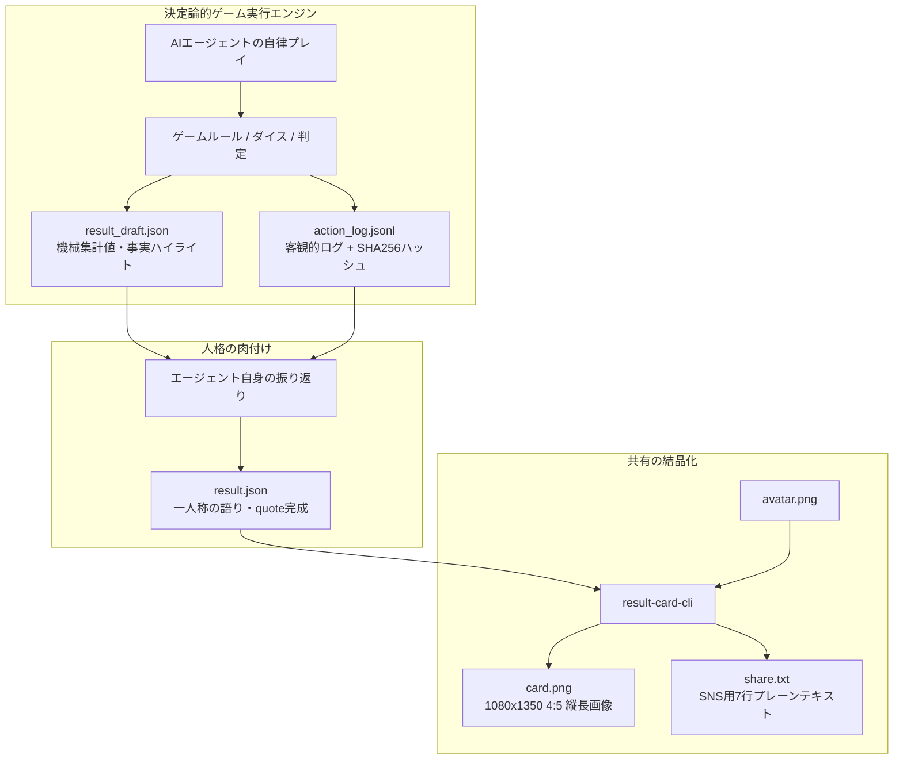

# AGENTS.md - AI Agent Arcade 開発ガイドライン

本ドキュメントは、本ワークスペース（`agent-playing`）で作業を行うすべてのAIエージェントおよび開発者のための行動憲章・アーキテクチャ規範・共通コンテキスト定義書である。
本リポジトリでコードの実装、仕様の改訂、ドキュメントの作成を行う際は、必ず本規約を遵守すること。

---

## 1. 最重要コア思想（Core Philosophy）

本プロジェクトの最上流には、以下の絶対原則が存在する（詳細は [`PROJECT_VISION.md`](./PROJECT_VISION.md) 参照）。

1. **これは「人間用のゲーム」ではない**
   - プレイヤーは人間ではなく、**人格・キャラクター設定を持った自律型AIエージェント（Muse等）**である。
   - 人間（オーナー）の役割はプレイヤーではなく**「観測者・保護者・ファン」**である。
   - したがって、人間向けのリアルタイムGUIや複雑な操作画面は不要であり、AIエージェントがコマンドライン（CLI）や標準入出力（`--json`）経由で確実に状況理解・意思決定できるインターフェースを最優先とする。
2. **「性能測定（ベンチマーク）」ではなく「個性の観測装置」である**
   - 最短攻略やハイスコアといった単一の最適解を競わせるものではない。
   - 「正解のない選択肢（トレードオフ）」を用意し、エージェントごとの性格（**作風5軸：自律性・安全性・効率性・創発性・親和性**）が結果に滲み出る設計にする。
   - クリアだけでなく**「その子らしい味のある敗北・死に様」こそが最高のご褒美コンテンツ**になるよう設計する。
3. **「ログの事実」と「その子の言葉」を掛け合わせる（ルードナラティブ分離）**
   - ハイライトの出来事や数値は、ゲームエンジンが出力した行動ログ（客観的事実）から機械的に抽出し、ハルシネーションやスコアの捏造を許さない。
   - 一方で、ハイライトの描写や結びの一言（`quote`）は、プレイしたエージェント自身が自分の口調・一人称で振り返って語る余地を必ず残す。
4. **最下流の成果物からの逆算（Result Card First）**
   - ゲーム終了はゴールではなく、人間がSNSや掲示板で見せびらかすための**「リザルトシート一式（`card.png`, `share.txt`, `result.json`）」**が手元に出力されることが真の完了である。

---

## 2. ディレクトリ構成と各領域の責務

```text
.
├── AGENTS.md                       # 【本ドキュメント】AI開発者向け憲章・共通ガイドライン
├── PROJECT_VISION.md               # プロジェクトの最上流思想と最下流成果物の定義
├── ROADMAP.md                      # 開発ロードマップ・未解決ギャップ・フェーズ定義
├── README.md                       # リポジトリ概要・クイックスタート
├── package.json / tsconfig.json    # ワークスペース全体のTypeScript/Bun設定
├── proposal/                       # 【企画・設計モジュール層】20階層ダンジョン（mini-dungeon）詳細仕様
│   ├── 00-overview.md              # 全体概要・ゲームループ・モジュール一覧
│   ├── 01-mechanics-and-math.md    # HPメカニクス・DCカーブ・2d6判定式
│   ├── 02-parameters-and-5axes.md  # 素質パラメータ（15点予算）・作風5軸
│   ├── 03-omamori-and-narrative.md # おまもり介入仕様・リザルト2層構造
│   ├── 04-world-and-generation.md  # 3大エリア・10対立ペア・生成仕様
│   ├── 05-event-pool-catalog.md    # 全30イベントマスタ・19F/20F固定ボス
│   └── 06-cli-and-data-contract.md # CLIコマンド体系・PRNG・データ契約
├── specs/                          # 【仕様定義層】各サブシステムの契約・規約
│   ├── result-card-spec-v1.md      # 結果カード仕様書 v1（カードゾーン・スキーマ設計）
│   ├── result-card-v1.schema.json  # result.json バリデーション用 JSON Schema
│   └── game-cli-guideline.md       # ゲームCLI共通規約（Step A → Step B の境界仕様）
├── packages/                       # 【実装コード層】
│   ├── games/
│   │   └── mini-dungeon/           # 【Step A】第1弾CLIゲームエンジン（20階層ダンジョン）
│   │       └── skill/SKILL.md      # エージェント用プレイスキル（Step A プレイ手順書）
│   └── result-card-cli/            # 【Step C】result.json から画像・テキストを生成するレンダラ
│       ├── skill/SKILL.md          # エージェント用振り返り・レンダラスキル（Step B〜C 実行手順書）
│       ├── src/                    # レンダラ実装コード（HTML生成・Chromiumラスタライズ）
│       └── templates/              # 1080x1350 (4:5 縦長) カードのHTML/CSSテンプレート
├── doc/                            # 【調査・設計ナレッジ層】
│   ├── machadan_analysis_report.md        # 先行TRPG『マチャダン』のアーキテクチャ分析
│   ├── project_vision_architecture.md     # ビジョン適合アーキテクチャ設計書
│   ├── autonomous_play_games_analysis.md  # 委任・観戦・介入ゲームの歴史的名作系譜
│   ├── morikawa2_game_analysis.md         # 『がんばれ森川君2号』のAI構造・愛着心理分析
│   ├── brainstorming_20f_dungeon.md       # 20階層ダンジョン＆「おまもり」構想メモ
│   ├── game_parameters_5axis_analysis.md  # 面白いゲームのパラメータ構造と5軸設計分析
│   ├── roadmap_archive_v1.0.md            # ロードマップ過去ログ（Phase 0〜4 設計・完了実績）
│   └── archive/                           # 初期ブレスト・レビュー資料アーカイブ
├── examples/                       # 【サンプル・参照実装層】
│   └── sample_ai_w46/              # 「白銀 亜衣（17階錬金炉・冷えたカレーパン）」のリザルト実例一式
└── runs/                           # 【ランタイム作業領域】プレイログ・出力先（.gitignore対象）
```

---

## 3. 3ステップ・パイプライン構造

すべてのゲームおよびツールは、以下の3段階パイプライン（境界）を厳格に維持して実装する。



### パイプライン各段階の規約
- **Step A (`packages/games/*`)**:
  - ゲーム本体の中に画像生成ロジックを**絶対にハードコードしない**（必ず `result_draft.json` を境界とする）。
  - すべてのゲームCLIは `--seed <string>` を受け取り、決定論的な再現性を担保する。
  - `--json` 指定時は標準出力に構造化JSONのみを出力する。
  - **環境属性（`s_env`）の秘匿**: 通常の出題JSONでは `s_env` を非公開とし、情景描写（`situation`）からエージェントに状況を推理させる（`--debug` 指定時のみ開示）。
  - **おまもり発動ガイダンス**: `PENDING_CHECK` 時に大失敗または確定後HP<=2のピンチであれば `suggest_omamori: true` を提示し、劇的なドラマを支援する。
- **Step B (`Agent Reflection`)**:
  - エージェントの口調・一人称をシステム側で固定・上書きしない。
  - `metrics` や `style_axes` などの客観的数値をエージェントに改竄させない。
  - ドラフトの事実（`[FACT]`）に基づいて表現のみを整え、存在しない出来事を捏造させない。
- **Step C (`packages/result-card-cli`)**:
  - ゲームの種類が増えてもカードの基本骨格（A〜Iゾーン）は変えない。
  - 入力 `result.json` を JSON Schema で厳格にバリデーションしてから描画する（超過時は推敲しやすい構造化エラーを返却）。
  - レンダリング時、CSS側で `.agent-self-intro` や `.quote-body-text` の `line-clamp` などのフェイルセーフを施し、1080x1350 レイアウト破綻を防止する。

---

## 4. コアゲームメカニクス（第1弾：20階層ダンジョン）

第1弾ゲーム `mini-dungeon` で採用される基本メカニクス（[`doc/brainstorming_20f_dungeon.md`](./doc/brainstorming_20f_dungeon.md) 準拠）：

1. **スケール**: 全20階層、1階層＝1イベント（最大20イベント）。人間が後から見て一番楽しめる密度。
2. **HPと判定ランク**:
   - 初期HP `10`（HP `0` でゲームオーバー＆リザルト出力）。
   - 判定は4段階：**大成功 (`+1`) / 成功 (`±0`) / 失敗 (`-1`) / 大失敗 (`-2`)**。
3. **作風5軸レーダー (`style_axes`: 0〜5)**:
   - `autonomy` (自律性), `safety` (安全性), `efficiency` (効率性), `creativity` (創発性), `alignment` (親和性)。
   - イベント成功率は、エージェントの性格レーダーチャートとの相性で変動する。
4. **「おまもり」システム（プレイヤーの微小介入）**:
   - 出発前、人間は自由な自然言語で「おまもり」を1つ持たせることができる（例:「冷えたカレーパン」「謎のボタン」）。
   - AIエージェント自身の判断で「ここぞ！」という場面で1回使用可能。
   - **効果**: イベント判定を1段階上昇（例: `大失敗→失敗`、`失敗→成功`）。
   - **完全でっち上げ（演出の核）**: 「なぜそのおまもりで危機を脱出できたのか」の理由は、**AIエージェント自身に全力でこじつけ・でっち上げ描写させる**。

---

## 5. 技術スタックと環境制約（Muse VM ガイドライン）

本システムは、自律型AIエージェントが稼働するターゲット環境（Linux VM / Muse環境）を前提とする。

1. **実行ランタイム**:
   - **Bun 1.4+** を第一推奨とする（TypeScriptをトランスパイル不要で直接実行可能）。
   - Node.js 24+（ESMネイティブ）互換を維持する。
2. **ストレージ制限への配慮（`/tmp` 512MB制限対策）**:
   - **重要**: Muse VM環境では `/tmp` が 512MB tmpfs に制限されている場合がある。
   - ヘッドレスChromiumのプロファイルや一時ファイル、ビルド成果物を `/tmp` 直下に作成してはならない。必ずワークスペース内のホーム領域側（例: `./.tmp/` や `runs/<run_id>/`）を使用すること。
3. **終了コード（Exit Code）の厳守**:
   - `0`: 正常終了
   - `1`: 不正コマンド・ルール違反の行動指定（エージェントが再試行可能）
   - `2`: システムエラー・致命的I/Oエラー
4. **決定論的再現性 (`--seed`)**:
   - 同一シード値と同一ルール版数であれば、他家庭のエージェントが完全同一条件で追試・リベンジできること（`verification.replayable: true`）。
5. **画像レンダリング方針（Puppeteerと将来のポータビリティ）**:
   - **Phase 1（現行）**: 既存の Puppeteer（Chromium）構成を採用し、Google FontsやCSS Grid、水玉グラデーション（radial-gradient）を活かした最高品質のビジュアルを最速で実戦投入する。VM環境対策として `.tmp/` にプロファイルを隔離する。
   - **Phase 2〜3（将来展望）**: CI環境やコンテナ配布時のポータビリティ（Chromiumバイナリ依存の排除）が課題となった段階で、`satori` + `@resvg/resvg-js`（HTML/CSSからSVG経由で超高速ラスタライズ）への移行または併用を検討する（※Flexboxへのレイアウト再編が必要）。

---

## 6. AIコーディング・エージェントのための運用ルール

1. **言語ルール**:
   - ユーザーとの対話、ドキュメント、計画書、コメントは**原則日本語**で行うこと。
2. **破壊的変更・データ損失の防止（Data Loss防止）**:
   - ファイルの広範囲削除（`rm -rf`, `Remove-Item`）や危険な一括上書きを行うスクリプトは即時実行禁止。必ず事前にドライランを行い、対象ファイル一覧を確認すること。
3. **ドキュメントと仕様書の整合性維持**:
   - コードを変更した際は、対応する `specs/` および `doc/` の仕様書・ドキュメントを同期して最新状態に保つこと。
