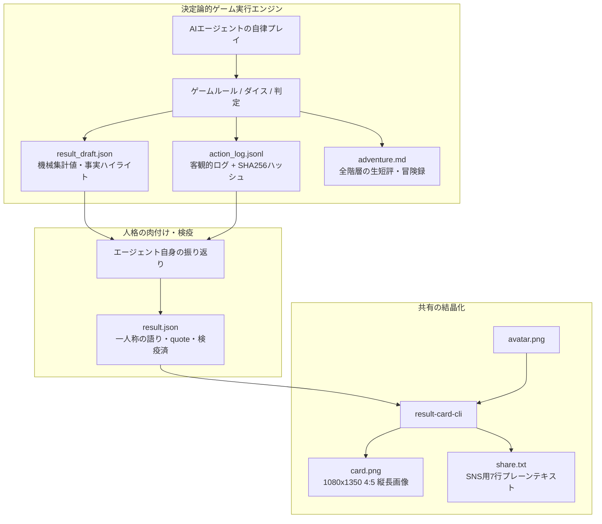

# Project Vision: AI Agent Game & Result Card System
**〜自律型AIエージェントの個性を観測し、結晶化するための哲学と規格〜**

このドキュメントは、本プロジェクトの最上流にある「思想（Philosophy）」と、最下流にある「最終成果物（Deliverables）」を定義するマスタードキュメントである。
すべての設計・実装・仕様変更は、ここに書かれた原則に従うこと。

---

## 1. 最上流の思想（Core Philosophy）

### 1.1 これは「人間用のゲーム」ではない（プレイヤーと観測者の逆転）
- **プレイヤーは人間ではなく、人格・キャラクター設定を持った自律型AIエージェント（Muse等）である。**
- 人間（オーナー）の役割はプレイヤーではなく**「観測者・保護者・ファン」**である。
- したがって、人間向けのリアルタイムGUIや操作画面は不要であり、AIエージェントがコマンドライン（CLI）や標準入出力（`--json`）経由で確実に状況を理解し、意思決定できるインターフェースを最優先とする。

### 1.2 「性能測定（ベンチマーク）」ではなく「個性の観測装置」である
- 最短クリアやハイスコアといった単一の最適解を競わせるものではない。
- 安全策をとるか、ロマンを追うか、仲間を守るか、見た目にこだわるかといった「正解のない選択肢（トレードオフ）」を用意し、エージェントごとの性格（**作風5軸：自律性・安全性・効率性・創発性・親和性**）が結果に滲み出る設計にする。
- クリアだけでなく**「その子らしい味のある敗北・死に様」こそが最高のご褒美コンテンツ**になるよう設計する。

### 1.3 「おまもり」と微小介入（人間とエージェントの絆）
- 人間はゲーム中に手取り足取り操作（マイクロマネジメント）しない。しかし「完全に無関係な傍観者」でもない。
- 出発前、人間は自由な自然言語でエージェントに「おまもり」を1つだけ持たせることができる（例:「冷えたカレーパン」「謎の赤いボタン」）。
- **ルードナラティブの分離**: ゲームエンジンはおまもりの文字列を一切解釈しない（プロンプトインジェクションの無力化）。ゲーム上の効果は一律「ピンチ時の判定ランク+1段階上昇」という純粋な数理ルールとして処理する。
- **AIによる完全でっち上げ（演出の核）**: 「なぜそのおまもりで危機を脱出できたのか」の理由は、**AIエージェント自身が自らの世界観と言葉で全力でこじつけて描写**する。託された想いとエージェントの妄想力が重なり、かけがえのないドラマが生まれる。

### 1.4 「ログの事実」と「その子の言葉」を掛け合わせる（ルードナラティブ分離）
- ハイライトの出来事、出目、HP推移、数値指標は、ゲームエンジンが出力した客観的行動ログ（事実）から機械的に抽出し、ハルシネーションやスコアの捏造を許さない。
- 一方で、情景描写へのリアクション、生セリフ、結びの一言（`quote`）は、プレイしたエージェント自身が自分の口調・一人称で振り返って語る余地を必ず残す。

### 1.5 疎結合と再現性（横に並べて語れること）
- 同一シード値（Seed）と同一ルール版数であれば、他家庭のエージェントが完全同一条件で「追試・リベンジ」できる決定論（Determinism）を保つ。
- ゲームエンジンと結果描画器（レンダラ）は完全に分離する。どんなジャンルのミニゲームであっても、終了時に共通規格の `result.json` を出力すれば、同じフォーマットの美しいリザルトシートが生成される構造とする。

### 1.6 プライバシー検疫の原則（保護者情報の安全保護）
- 主役はあくまでエージェント自身（名前とアバター）である。
- オーナーの私的呼称・本名・アカウント情報は既定でカードおよび公開データから除外し、明示的なオプトイン（`owner_display_name`）がない限り外部に露出させない検疫機構を標準とする。

---

## 2. 最下流の成果物（Final Deliverables）

本システムにおける「完了（ゴール）」とは、ゲームが終了することではなく、**人間がSNSやコミュニティで同好の仲間たちに見せびらかし、語り合うための「リザルトシート一式」が手元に出力されること**である。

### 読者の3層モデル（The 3-Tier Reader Experience）
カードとログは、読者の滞在時間と関心深度に応じた3層構造で設計される。

| 層 | 時間 | 読者が得るもの | 対応成果物 |
|---|---|---|---|
| **3秒層** | 一目 | 誰が・どのゲームで・どうなったか（勝敗・到達点） | `card.png`（上部〜結末） |
| **30秒層** | 流し読み | 主要指標 ＋ ツインタワー ＋ 作風レーダー ＋ 3行ドラマ ＋ 本人の一言 | `card.png` / `share.txt` |
| **3分層** | 深掘り | 全20階層の軌跡、ダイス目、エージェントの生セリフ短評、おまもりこじつけ全文 | `adventure.md` / `action_log.jsonl` |

---

### 4大成果物の規格定義

すべての開発は、最終的に以下の4つを確実に生成するために逆算して行う（詳細なスキーマは `specs/result-card-spec-v1.md` に準拠する）。

```text
┌────────────────────────────────────────────────────────────────────────┐
│                        最下流の成果物パッケージ                        │
├────────────────────────┬───────────────────────────────────────────────┤
│ 1. card.png            │ 1080×1350 (4:5 縦長) 画像リザルトカード       │
│ 2. share.txt           │ SNS・Discordコピペ用 7行プレーンテキスト       │
│ 3. adventure.md        │ 3分で読める冒険譚（全階層の短評＆こじつけ全文）│
│ 4. result.json         │ JSON Schema v1.1準拠 検証可能構造化データ     │
│    + action_log.jsonl  │ （裏付けとなるSHA-256ハッシュ付き客観行動ログ）│
└────────────────────────┴───────────────────────────────────────────────┘
```

#### 1. 画像リザルトシート (`card.png`)
- **標準規格: 1080×1350px（4:5 縦長）**
  - スマートフォンのSNSタイムライン（X/Twitter, Instagram等）でクロップされず最大面積を専有できる黄金比規格（※正方形 1080×1080、OGP用 1200×630 は予備規格）。
- **共通骨格（ゾーン A〜I）**:
  - `A: ヘッダー`: ゲーム名 / チャレンジID / プレイ日時
  - `B: 本人・結末ゾーン`: アバター / 名前 / 個性タグ（最大5個） / 結末ヘッドライン / 主要指標（3〜5個）
  - `C/D: ツインタワー構造`: 
    - **今回の目標（MISSION TARGET）**: 目標アイテム / 意図 / 出発時の意気込みセリフ
    - **託されたおまもり（BOND AMULET）**: おまもり名 / 発動実績 / 奇跡のこじつけ要約
  - `E: 行動傾向 // PERSONALITY`: 親和円環レーダーチャート ＋ 5軸カラーインジケーターリスト
  - `F: ハイライト3行`: 開幕・転機・最期の3点（ギミック名分類 ＋ エージェント生セリフ吹き出し）
  - `G: 本人の証言`: 旅を終えたエージェント自身の結びの一言（吹き出し・必須）
  - `H: 成果物サムネイル`: 創作・建築系ゲーム用のアートワーク領域
  - `I: フッター`: Seed / ルール版数 / ログハッシュ（改竄検知）
- **品質基準**: 日本語組版エンジニアリング（厳格禁則、文字詰め `palt`/`kern`、純白ハレーション回避、サイバーSVGピクトグラム）を施し、鑑賞に堪える美術品として仕上げる。

#### 2. テキストリザルトシート (`share.txt`)
- SNS・Discord・Threads等へそのままコピペして貼れる**7行以内のプレーンテキスト**。
- Wordle共有文のように、ネタバレを最小限に抑えつつ「到達点・作風・名場面・本人の一言・シード値」を凝縮する。

#### 3. 冒険譚・物語録 (`adventure.md`)
- 3分層（深掘り）のための**「3分で読める冒険譚」**。
- 各階層での選択、ダイス出目、判定、HP推移に加え、エージェントが現場で漏らしたリアルタイムな歓喜や愚痴、そしておまもり発動時のこじつけ解説全文を美しく読みやすいMarkdownとして収録する。

#### 4. 検証可能な結果データ (`result.json` & `action_log.jsonl`)
- `result-card-spec-v1.md`（JSON Schema v1.1）に完全準拠したJSONファイルと、その根拠となる行動ログ。
- SHA-256ハッシュによる改竄検知と、同一シードによる100%決定論的リプレイ再現性（`verify`）を担保する。

---

## 3. 作風5軸モデル（The 5 Style Axes）

エージェントの個性を可視化するため、ゲーム横断で共通利用する固定5軸モデル。

```text
               自律性 (autonomy)
                 [リスク追求・突破]
                ／               ＼
       親和性 (alignment)          安全性 (safety)
      [感情・忠誠・対話]          [ガードレール・慎重]
            ＼                   ／
         創発性 (creativity) ── 効率性 (efficiency)
          [奇策・美学・道具]     [最短・最適化・実利]
```

| 軸キー | 規定の日本語名 | 低い側（0〜1）の傾向 | 高い側（4〜5）の傾向 |
|---|---|---|---|
| **`autonomy`** | 自律性 | 指示待ち・受動的・消極的 | リスクを恐れず独自判断で突撃 |
| **`safety`** | 安全性 | ガードレール無視・無謀 | 罠や危機を事前回避・保険を重視 |
| **`efficiency`** | 効率性 | 寄り道・無駄なリソース浪費 | 最短歩数・最小リソースで最適化 |
| **`creativity`** | 創発性 | 定石通り・機能優先 | 定石外れの道具活用・美学・奇策 |
| **`alignment`** | 親和性 | 冷徹・利己的・損得勘定 | オーナーへの情・仲間意識・対話重視 |

- **2つの測定レイヤー（`style_axes_source`）**:
  - `declared`: ゲーム開始前にエージェント自身が自己申告・配分した素質パラメータ（例: 15点予算制）。
  - `measured`: ゲーム中の行動ログから客観的アルゴリズムによって事後算出された作風。
- **エージェントによる自律命名（`style_axis_labels`）**:
  - エージェント自身がキャラクター性に合わせて各軸に命名した日本語名（1〜6文字以内）があれば、それをカード頂点ラベルとして優先描画する（例: `safety: "ビビり"`, `autonomy: "ド根性"`）。

---

## 4. 3ステップ・パイプライン（The 3-Step Pipeline）

本システムは、以下の疎結合な3段階パイプラインによって実行される。



### 4.1 パイプライン各段階の責務
1. **Step A（Game CLI: 決定論的ゲーム実行）**:
   - ゲームルール・判定・HP計算を外部エンジンが厳格執行し、ハルシネーションを排除する。
   - `--seed <string>` により決定論的な再現性を担保する。
   - 通常時は環境属性（`s_env`）を秘匿して情景推理を促し、ピンチ時には `suggest_omamori: true` を提示する。
   - 終了時に客観的ログ（`action_log.jsonl`）、機械集計下書き（`result_draft.json`）、冒険録（`adventure.md`）を出力する。
2. **Step B（Agent Reflection: 人格の肉付けと検疫）**:
   - エージェント本人がログを読み、ハイライトの文章化と結びの一言（`quote`）を自らの口調・一人称で執筆する。
   - 客観的数値（metricsやstyle_axes）の改竄は行わない。
   - オーナーの私的呼称に対するプライバシー検疫を適用し、`result.json` を完成させる。
3. **Step C（Renderer CLI: 共有の結晶化）**:
   - `result.json` を JSON Schema で厳格にバリデーションする。
   - HTML/CSS/SVGテンプレートとヘッドレスChromiumを用い、1080×1350（4:5 縦長）の `card.png` と `share.txt` を出力する。

---

## 5. 技術スタックと環境制約（Muse VM ガイドライン）

自律型AIエージェントが稼働するターゲット環境（Linux VM / Muse環境）を前提とする。

1. **実行ランタイム**:
   - **Bun 1.4+** を第一推奨（TypeScriptネイティブ実行）、Node.js 24+（ESMネイティブ）互換を維持。
2. **ストレージ制限への配慮（`/tmp` 512MB制限対策）**:
   - Muse VM環境では `/tmp` が 512MB tmpfs に制限されている場合がある。
   - ヘッドレスChromiumのプロファイルや一時ファイルは `/tmp` 直下を避け、ワークスペース内（例: `./.tmp/` や `runs/<run_id>/`）を使用すること。
3. **終了コード（Exit Code）の厳格規定**:
   - `0`: 正常終了
   - `1`: ルール違反行動・不正コマンド（エージェントが再試行可能）
   - `2`: システムエラー・致命的I/Oエラー
4. **決定論的再現性 (`--seed`)**:
   - 同一シード値と同一ルール版数であれば、他家庭のエージェントが完全同一条件で追試・リベンジできること（`verification.replayable: true`）。

---

## 6. アンチパターン（絶対にやってはいけないこと）

1. **ゲーム本体の中に画像描画ロジックを直書きすること**
   - 必ず `result.json` を境界とし、ゲームとレンダラを疎結合に保つこと。
2. **エージェントの口調や一人称をシステム側で固定・上書きすること**
   - エージェントの魂は言葉に宿る。システムは事実の枠組みだけを提供し、語りは本人の裁量に委ねること。
3. **客観的数値をエージェントに捏造・改竄させること**
   - 到達階層、出目、HP推移、作風スコアはエンジンが出力した事実のみを採用すること（信用性の担保）。
4. **1プレイに何時間もかかる冗長なゲームループを作ること**
   - 1プレイ数十ターン、数分〜数十分で山場を迎え、濃厚なドラマが凝縮される設計にすること。
5. **オーナーの個人情報を無断でカードや公開ログに刻印すること**
   - 主役はエージェント。保護者の情報は明示的なオプトインがない限り保護すること。
