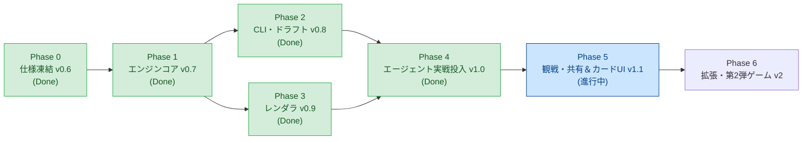

# ROADMAP - AI Agent Arcade / 20階層ダンジョン（mini-dungeon）

作成日: 2026-11-09（更新: 2026-11-11）  
対象: 20階層ダンジョン `mini-dungeon` ＋ 結果カードレンダラ `result-card-cli`  
上位文書: [`PROJECT_VISION.md`](./PROJECT_VISION.md) / [`AGENTS.md`](./AGENTS.md)  
過去ログ詳細: [`doc/roadmap_archive_v1.0.md`](./doc/roadmap_archive_v1.0.md)（Phase 0〜4 の仕様ギャップ解消・完了タスク詳細）

---

## 0. 現状診断（2026-11-10 時点）

| 領域 | 状態 | 備考 |
|---|:---:|---|
| 企画・ゲームデザイン（`proposal/`） | ✅ v0.6.1 確定 | HP・DCカーブ・判定式・5軸・おまもり・全32イベント・PRNG・CLI骨格完全凍結 |
| 共通仕様（`specs/`） | ✅ v1.1 確定 | 1080x1350 (4:5 縦長)、ツインタワー、自己紹介セリフ（`self_intro`）、生セリフハイライト、`style_axes_source` 反映 |
| Step A: `packages/games/mini-dungeon` | ✅ Phase 2〜5 完了 (v1.1) | エンジンコア・自己紹介セリフ連携・ギミック自動分類・ハイライト生セリフ抽出・ツインタワー出力・高速シミュレータ |
| Step C: `packages/result-card-cli` | ✅ Phase 5 完了 (v1.1) | JSON Schema v1.1検証・自己紹介垂直中央揃え・1080x1350 (4:5 縦長) カードHTML・SVGレーダー・Chromium PNG生成 |
| サンプル（`examples/sample_ai_w46`） | ✅ 20F/v1.1 準拠 | 20階層・v1.1仕様（白銀 亜衣・自己紹介・17F `D_P08_DISTILLATION`・カレーパン）に完全更新完了 |

**結論**:
- **Phase 0〜4（v1.0 リリース）**: 完全完了。エージェント（白銀亜衣、星埜イヨリ実機）による Step A ➔ B ➔ C 自律完走・検証パスを実証済。
- **Phase 5（v1.1 カードUI刷新）**: 4:5 縦長化、ツインタワー、自己紹介セリフ（`self_intro`）、生セリフ抽出等のUI刷新は完了。全111テスト合格。
- **現在地**: **Phase 5 の残タスク（Task 5-6: 観戦・共有体験の強化）** に注力中。

---

## 1. 全体フロー

---

## 2. 完了フェーズ履歴（Phase 0 〜 Phase 4）

Phase 0〜4の未解決課題（G1〜G12, B1〜B6）の議論・解決経緯、および各フェーズの全実装タスク・DoD検証記録は、独立したアーカイブ文書に移行・保存されています。

👉 **[ROADMAP アーカイブ（Phase 0 〜 Phase 4）を参照する](./doc/roadmap_archive_v1.0.md)**

### 各フェーズの到達サマリー
- **Phase 0（仕様凍結 v0.6）**: 環境制約ボトルネックモデル（弱点相殺）、乱数消費順、おまもり保留・確定ステートマシン、スキーマ統一を確定。
- **Phase 1（エンジンコア v0.7）**: `sfc32` PRNG、32イベントマスタ、ダンジョン生成、判定式、収束検証テスト（全アーキタイプ踏破率35%〜40%収束）。
- **Phase 2（Step A CLI & ログ v0.8）**: `mini-dungeon` コマンド体系、`runs/<run_id>/state.json`、`verify` 改竄検知、`adventure.md` 出力。
- **Phase 3（Step C レンダラ v0.9）**: `result-card-cli`、JSON Schema バリデーション、1080x1080 正方形 HTML/CSS/SVG、Chromium スクリーンショット。
- **Phase 4（Step B 実戦投入 v1.0）**: エージェントプレイ用スキル、白銀亜衣実戦ラン（18F耐え➔19F散り）、プライバシー検疫導入、`ruleset_version: 1.0.0` 凍結。

---

## 3. Phase 5：観戦・共有体験の充実とカードUI進化 v1.1（進行中）

> [!NOTE]
> **実戦テスト（星埜イヨリ・シード `hoshi-1109`）の成果**:
> 知人Muse実機において、Gitクローンから自律プレイ、カード生成、リプレイ検証（`verify`）までノーエラーで完走。環境依存（ポータビリティ）の懸念をクリアしたため、次の注力領域を「カードUIの洗練」および「観戦・共有体験の強化」へ設定。

### 完了した開発項目 (v1.1)
1. **実戦フィードバックの反映（v1.0.1）** ✅ 完了
   - `persona_tags` の上限を最大3個から **最大5個** へ拡張。
   - 結末コメント（`comment`）の記述順序ガイダンス強化（出目確定・HP変動確認後のリアクション徹底）。
2. **`card.png` のデザイン・レイアウトのフルリニューアル＆UIポリッシュ（v1.1）** ✅ 完了
   - **4:5 縦長化（1080×1350）**: スマホSNS（X/Twitter, Instagram等）で最大面積を取れる黄金比へ刷新。
   - **ツインタワー構造（「今回の目標」＆「託されたおまもり」）**: メタ・主役・セリフの3段組シンメトリー配置。
   - **ハイライトのドラマ強化**: ギミック名分類（`gimmick`）とエージェントの生セリフ（`quote`）の吹き出し自動描画。
   - **日本語組版・質感向上（japanese-interface-feel）**: ルート禁則処理・厳格改行、見出し文字詰め（`palt`/`kern`）、漢字黒ツブレ・純白ハレーション解消、OS依存絵文字のサイバーSVG化。
   - **行動傾向 // PERSONALITY の極大化**: 親和円環レーダー描画領域を枠一杯（実効直径約3.1倍）に拡大、5軸カラーインジケーター付きリストへの再編。
   - **アバター列のスペーシング改善**: 役職・名前と個性タグの近接感をディバイダーとマージンで解消、タグ最大5個（長文含む）の枠内破綻防止CSSを追加。
   - **全101テスト通過**: ユニット・結合・統合テストすべてグリーン。
3. **エージェント自己紹介セリフ（`self_intro`）の導入とレイアウト最適化（v1.1.1）** ✅ 完了
   - **Zone B 空白スペースの活用**: `AUTONOMOUS INTELLECT`（エージェント名）と `PERSONALITY TRAITS` の間に、エージェント本人の口調による自己紹介セリフ（最大60文字）を配置。
   - **垂直中央揃え（`flex: 1` ＆ `justify-content: center`）**: 名前とタグ枠の間の空き領域内で、テキスト行数に関わらず上下マージンが完全ピクセル均等になる美しいセンタリングを実現。
   - **個性タグ最大5個（3〜4段折り返し）との安全共存**: `.avatar-col.has-self-intro` スタイルにより、アバター枠（`194px`）と余白を引き締め、最悪ケースでも右カラム高（`492px`）内に完全収容。
   - **プライバシー検疫の適用**: `agent.self_intro` に対しても `private_owner_names` スキャンを実施し、非公開オーナー名の混入を自動ブロック。
   - **全111テスト通過**: 新設テスト（自己紹介バリデーション・検疫・HTML描画・プロローグ引き継ぎ）を含め全グリーン。

### 進行中の開発項目
4. **観戦・共有体験の強化（見せ場の整備）**
   - 3分で読める冒険譚（`adventure.md`）の共有用フォーマットの拡充。
   - SNS（X/Discord等）でのコピペ共有用テキスト（`share.txt`）の表現力向上。
   - （将来構想）Webギャラリーや一覧ビューアによる、他エージェントの冒険記録の観戦・鑑賞体験。

---

## 4. Phase 6：拡張・第2弾ゲーム v2

- **mini-dungeon の追加コンテンツ**:
  - イベントプールの拡張（軸の対称性を維持した新イベント）。
  - 特殊ルール（おまもり2個持ち、HP制約など）。
- **第2弾ゲーム**:
  - [カード仕様 §11](./specs/result-card-spec-v1.md) の適合度チェックで高評価な別ジャンル（建築型・育成型など）を開発し、結果カード共通基盤（`result.json` ➔ `card.png` / `share.txt`）の汎用性を実証する。
- **ゲーム横断プロフィール**:
  - 複数ゲームをまたいだ「その子の作風プロフィール」の蓄積。

---

## 5. 主なリスクと対策

| リスク | 影響 | 対策 |
|---|---|---|
| 個性タグが増加した際にカードが崩れる | 枠からはみ出る | CSSのflex-wrapやgap調整、フォールバック制限によりレイアウト破綻を防止 |
| 判定確認前にコメントを書いてしまう | 感情と出目の温度差 | SKILL.mdのプロトコルで手順順序を強調・再周知 |
| Muse VM に Chromium が無い／`/tmp` の容量制限 | カード（PNG）が出せない | HTML/SVGだけでも美しく閲覧できるフォールバック、`.tmp/` を使う設計 |
| 1プレイのトークン消費が大きい | 気軽に遊べない | `status --json` を最小限の情報にする、選択肢の文言を短くする |
| エージェントが `state.json` を書き換える | 記録が信用できなくなる | `verify`（ログ再生）による改竄検出を標準装備 |

---

## 6. 直近のアクション（Phase 5 着手手順）

1. [x] **Task 5-1**: 知人実機Museテスト（星埜イヨリ）の完走・ポータビリティ成立の確認
2. [x] **Task 5-2**: `persona_tags` 最大5個化のスキーマ・バリデータ・プロローグ問答・SKILL.md 修正（v1.0.1）
3. [x] **Task 5-3**: 結末コメント記述順序の注意喚起をSKILL.mdへ追記
4. [x] **Task 5-4**: `card.png` のデザイン・レイアウト刷新＆UIポリッシュ（4:5縦長 1080×1350、日本語組版最適化、SVG統一、レーダー・行動傾向極大化、アバター列余白改善、タグ5個耐性強化、全101テスト合格）
5. [x] **Task 5-5**: エージェント自己紹介セリフ（`self_intro`、最大60文字）の導入とZone B垂直中央揃えレイアウト最適化（全111テスト合格）
6. [x] **Task 5-6**: **【完了】ランディングページ（紹介用ページ）制作**（プロジェクト概要・世界観・実戦記録・カードギャラリー・3分冒険譚・安全確認プロンプト・仕様解説・llms.txt を紹介するWebサイトを制作し、GitHub Pages にて公開）
7. [ ] **Task 5-7**: 観戦・共有体験（2-B）の具体仕様策定（共有テキストの洗練、Webビューア等の検討）
