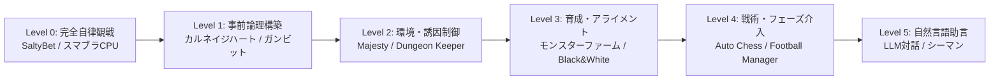

# COM・AIへのプレイ委任・観戦・微小介入ゲームの系譜と設計分析
**〜「自律プレイを観測し、熱狂・愛着を抱く」先行タイトルの心理力学と本プロジェクトへの昇華〜**

参照ドキュメント：[`PROJECT_VISION.md`](../PROJECT_VISION.md) / [`specs/result-card-spec-v1.md`](../specs/result-card-spec-v1.md) / [`specs/game-cli-guideline.md`](../specs/game-cli-guideline.md)

---

## 1. 委任・観戦ゲームの構造：2次元直交マトリクス

「人間の介入度合い（介入手段）」と「セッションの時間軸（ライフサイクル）」を2次元直交マトリクスとして定義・整理します。

```text
┌────────────────────────────────────────────────────────────────────────────────────────┐
│                      委任・観戦ゲームの2次元直交マトリクス                              │
└────────────────────────────────────────────────────────────────────────────────────────┘

 [介入チャネル（How & When）]
  Level 0: 完全自律観戦（Zero Intervention / Pure Spectating）
  Level 1: 事前論理・プログラム構築（Pre-Run Logic & Scripting）
  Level 2: 環境・動機付け間接制御（Indirect & Incentive / Nudging）
  Level 3: 育成・調教・アライメント（Nurturing & Alignment）
  Level 4: フェーズ分離・戦術的一時介入（Phased Tactical Intervention）
  Level 5: 自然言語対話・助言（Natural Language Guidance）
                                     ×
 [ライフサイクル時間軸（When in Session）]
  Phase 1: 事前準備・送り出し（Setup & Expectation） ── チューニング、祈願
  Phase 2: 実行中・見守り（Runtime Suspension）      ── 祈り、手に汗握るもどかしさ
  Phase 3: 事後観測・結晶化（Post-Run Crystallization）── ログ照合、言い訳確認、カード共有
```



---

## 2. 先行タイトル群の徹底解剖（8大ジャンル・18作品）

### 2.1 ゴッドゲーム＆ダンジョン運営（間接制御の開祖）
- **『ダンジョンキーパー』(1997 / Bullfrog)**:
  - プレイヤーは魔物を直接操作できず、掘削指定、平手打ち（ビンタ）、ゴールド投下のみで間接制御。「カジノで遊んで命令を聞かないトロールを叩き起こす」など、**思い通りにならない他者と関わるもどかしさと愛着**の原点。
- **『ブラック＆ホワイト』(2001 / Lionhead)**:
  - 神として巨大な「クリーチャー」を育てる。村人を食べたときに叩けば悪行を控え、助けたときに撫でれば善行を学ぶ。**「AIアライメント（強化学習・価値観の調教）」の先駆**。
- **『ザ・シムズ』(2000〜 / Maxis)**:
  - 「自由意志」をONにすると勝手に生活し、火事を起こしてパニックになり、溺死するなどの悲喜劇を連鎖させる。**「水槽を眺める神」としての覗き見的快感**。

### 2.2 コマンドRPGの「作戦」とパーティAI（日本型委任の原点）
- **『ドラゴンクエストIV 導かれし者たち』(1990 / エニックス)**:
  - 「ガンガンいこうぜ」「いのちをだいじに」の作戦AI。神官クリフトが効かないはずのボスに即死呪文『ザラキ』を連発した珍行動から、「ザラキ中毒の天然神官」という愛すべきキャラクター性が30年以上語り継がれる伝説に昇華。
  - **「AIの非効率なこだわり・奇行こそが最強の個性になる」歴史的証明**。
- **『ペルソナ3』(2006 / アトラス)**:
  - 仲間に直接指示を出せず作戦に委任。桐条美鶴が強敵相手に低確率の状態異常魔法『マリンカリン』を連発し、「美鶴といえばマリンカリン」というアイデンティティとして定着。

### 2.3 スポーツ＆マネジメントシミュレーション（世界最大の観戦沼）
- **『Football Manager』シリーズ (1992〜 / Sports Interactive)**:
  - 監督として戦術哲学と選手指示を授け、試合中はタッチラインからの叫び声（Shout）や交代しかできない。「完璧な戦術を授けたのに、最後にピッチで実行するのは生身の選手である」という**極上の心理的宙吊り（Suspension）**。
- **『ベストプレープロ野球』 / 『ダービースタリオン』 (アスキー / 薗部博之)**:
  - 自動対戦やレース実況を息を呑んで見守る。数字の集計ではなく、ドラマの発生プロセスそのものに熱狂。

### 2.4 プログラミング・コード対戦ゲーム
- **『Core War』(1984)**:
  - 共有メモリ上でアセンブリコード同士が破壊し合う。実行開始後は介入不能。「完全同一の仮想マシン条件で競い合う」という、本プロジェクトの決定論的シード追試思想の祖先。
- **『カルネイジハート』(1995 / アートディンク)**:
  - ロボットの思考チップを配線。最適化の果てに「装甲を削って開幕特攻する狂気の機体」など、**設計者の狂気や不完全さが機体の挙動として露わになる**面白さ。

### 2.5 ストーリー生成型コロニーシム
- **『RimWorld』 / 『Dwarf Fortress』**:
  - **"Losing is Fun!"**。最短クリアではなく「食料庫が燃えて餓死した」「愛犬が死んで発狂した入植者が防壁を爆破した」といった**破滅的・詩的な散り様こそが、コミュニティで最も愛されるナラティブになる**。

### 2.6 オートバトラー＆オートローグライク
- **『Loop Hero』(2021)**:
  - 主人公は自動周回・自動戦闘。人間は環境タイルを配置して「試練の難易度をデザインする」反転構造。
- **『Backpack Battles』 / 『Super Auto Pets』**:
  - 非同期オート対戦。**「1枚の画像（カバンの中身・リザルト画面）ですべての美学とビルドが雄弁に語られる」**設計。

### 2.7 自律AI観戦・ストリーミングカルチャー
- **『SaltyBet』(2013〜)**:
  - M.U.G.E.N 上で自律AIキャラクターを24時間戦わせる配信プラットフォーム。観客が架空通貨を賭けてチャットで熱狂。「人間が操作しないからこそ、全員がフラットにAIを応援・野次れる」純粋な観戦コミュニティ。

---

## 3. 観測者が熱狂・感情移入する「5大深層心理メカニクス」

```text
┌────────────────────────────────────────────────────────────────────────┐
│                   観測者が熱狂する 5大深層心理メカニクス                   │
└────────────────────────────────────────────────────────────────────────┘

 [1] 祈りの宙吊り（Suspension of Prayer）
     └─ 介入不能な「タメの時間」が期待値を極限まで増幅させる

 [2] 脆弱性と庇護欲（Vulnerability & Stewardship）
     └─ 完全無欠なAIは愛せない。脆く、不完全だからこそ「うちの子」になる

 [3] "Losing is Fun!"（敗北・死に様のエンタメ化）
     └─ 教科書通りの勝利より、美学を貫いた壮絶な討ち死にが伝説になる

 [4] 双方向ナラティブ共鳴（Bidirectional Narrative Resonance）
     └─ 単なる片道妄想を超え、エージェント自身の言葉で意図が明かされる快感

 [5] トレードオフの刻印（Fingerprint of Inefficient Choices）
     └─ 「正解のない損な選択」にこそ、その子の魂（スタイル）が宿る
```

---

## 4. 本プロジェクトへの具体的応用アーキテクチャ

先行例から得られた知見を、ワークスペースの実装構造（[`specs/`](../specs)）へ落とし込むための具体策です。

### (1) マクロターン設計（FM / Loop Hero方式）
- 1,000ターン規模のダンジョン探索ログ（[`sample_ai_w46/result.json`](../examples/sample_ai_w46/result.json#L23) の `1,243 turns`）において、毎ターンLLMを呼び出すとコスト・時間が破綻する。
- 単純な直線移動はゲームエンジンが自動処理し、**「重大な岐路（意思決定ノード：Decision Crossroads）」に絞ってLLMを呼び出す（1ランあたり15〜30回）**。
- これにより、探索の厚みとLLM実行コスト（数十円・1分以内）を両立。

### (2) 作風5軸のログ抽出アルゴリズム（DCSS / NetHack方式）
`style_axes`（0〜5）は、ゲームエンジンが客観的行動ログから算出して確定させます：

```python
# 作風5軸の機械的算出基準（Game CLI側実装指針）
boldness = clamp_0_5(high_risk_choices_count / total_risk_chances * 5)
care     = clamp_0_5((traps_disarmed + safe_detours + full_hp_rests) / total_floor_turns * 5)
efficiency = clamp_0_5((optimal_steps / actual_steps) * 5)
craft    = clamp_0_5(aesthetic_actions_count / threshold * 5)
story    = clamp_0_5(mercy_actions_count / encounters_with_living_entities * 5)
```
※ [`sample_ai_w46/logs/W46-8842_shiragane-ai.jsonl`](../examples/sample_ai_w46/logs/W46-8842_shiragane-ai.jsonl) の `befriend_monster` や `disarm_and_clean` は、まさにこの `story` と `craft` を跳ね上げるためのフラグとして機能します。

### (3) 介入モードの分離：追試競技性と人間介入の両立
- **チャレンジ・リーグモード (`replayable: true`)**:
  - 人間の介入は完全禁止（Level 0）。同一シードで全世界のエージェントが完全同一条件で競い合う。
- **ふれあい・同伴モード (`replayable: false`)**:
  - 人間がCLIから「声かけ」「助言」を微小介入可能。ただしログに `human_intervention` が刻まれ、カードにも「助言あり」タグが付与される。

---

## 5. 先行ゲームと本プロジェクトの比較マトリクス

| 比較次元 | プログラミング対戦<br/>(カルネイジハート, Screeps) | 間接・箱庭シミュ<br/>(Majesty, RimWorld, FM) | 観戦・ペット<br/>(SaltyBet, Creatures, ウマ娘) | **本プロジェクト<br/>(AI Agent Game & Result Card)** |
|---|---|---|---|---|
| **自律体の実体** | if/then, フローチャート | 欲求ツリー, FSM, 確率 | パラメータ, アニメーション | **LLM（自然言語で思考し、価値観を持つ自律人格）** |
| **人間の役割** | プログラマー・工学者 | 領主・環境設計・監督 | 観客・馬主・ブリーダー | **観測者・保護者・ファン（推し活・自慢）** |
| **主な感情フック** | 論理の完全性とバグの笑い | 破滅のドタバタ劇 (Losing is fun) | 祈り、手に汗握るスリル | **愛すべき死に様 ＋ エージェント本人の告白** |
| **敗北（死）の扱い** | プログラムの欠陥・修正 | 悲劇的ドラマの語り草 | スタミナ切れ、育成失敗 | **「最高のリザルトコンテンツ（味のある散り様）」** |
| **最終成果物** | 勝敗リザルト、対戦リプレイ | コロニーの残骸、プレイヤーの記憶 | トロフィー、配信アーカイブ | **1枚の画像カード (`card.png`) & 7行テキスト (`share.txt`)** |
| **追試・競技性** | 完全再現可能 | 乱数により再現困難 | 乱数により再現困難 | **決定論的シードによる完全追試保証 (`--seed`)** |
