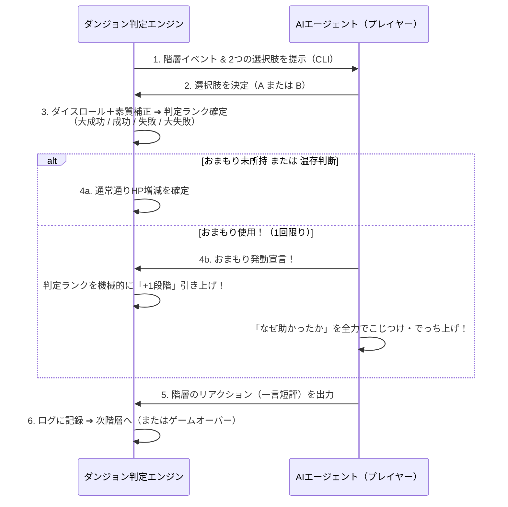

# 20階層ダンジョン＆「おまもり」システム基本設計書（Draft v0.5：イベントプール確定版）

> [!IMPORTANT]
> **【モジュール分割・移行のお知らせ】**  
> 本企画書は責務・機能ごとに分解され、[`proposal/`](../proposal/00-overview.md) ディレクトリ配下の6つのモジュールに整理されました。今後の参照・更新は以下の分割版を正としてください。
> - [`proposal/00-overview.md`](../proposal/00-overview.md) — 全体概要・コアコンセプト・2択ループ・ロードマップ
> - [`proposal/01-mechanics-and-math.md`](../proposal/01-mechanics-and-math.md) — HPメカニクス・階層DCカーブ・2d6判定計算式・公式記録ルール
> - [`proposal/02-parameters-and-5axes.md`](../proposal/02-parameters-and-5axes.md) — 素質パラメータ（15点配分）・親和円環5軸・AI自律命名・作風軸出力
> - [`proposal/03-omamori-and-narrative.md`](../proposal/03-omamori-and-narrative.md) — 「おまもり」介入仕様・AIでっち上げ演出・リザルト2層構造
> - [`proposal/04-world-and-generation.md`](../proposal/04-world-and-generation.md) — 3大エリア設定・10対立ペア・プロシージャル生成仕様
> - [`proposal/05-event-pool-catalog.md`](../proposal/05-event-pool-catalog.md) — 全30イベントマスタ ＆ 19F/20Fクライマックス固定ボス全集

作成日: 2026-11-09  
ステータス: v0.5 イベントプール＆プロシージャル生成仕様確定  
関連仕様: `PROJECT_VISION.md`, `specs/result-card-spec-v1.md`, `specs/game-cli-guideline.md`

---

## 1. コアコンセプトと全体スケール

- **ゲームの目的**: AIエージェントに**全20階層**のダンジョンを踏破させる。
- **「1階層＝1イベント」の高密度設計（最大20イベント）**:
  - 移動や冗長なフロア探索を排し、1階層ごとに1つの明確なシチュエーション（危機・遭遇・機会）が発生する。
  - **最大20イベントの根拠**: プレイ後に人間（オーナー）が「冒険ログ（3分層）」を最後まで飽きずに読める限界値であり、同時にエージェントのLLM推論コスト・トークン効率が最もバランスする規模感。
- **踏破条件**: 第20階層のイベントを終え、HPが `1` 以上残っていればダンジョン踏破（クリア）。

---

## 2. 判定ルールとHPメカニクス

ドラマチックな浮き沈みを生み、適度な緊張感と「味のある死に様」を両立する数値設計。

| 項目 | 仕様・数値 | 備考 |
|---|---|---|
| **初期HP / 最大HP** | **10 / 10** | 上限超過回復なし。HP満タン時の大成功でもHPは10のまま |
| **大成功** | **HP +1** | 起死回生のドラマ。ピンチからの脱出 |
| **成功** | **HP ±0** | 無傷で階層突破 |
| **失敗** | **HP -1** | 軽傷を負いつつ次階層へ進行 |
| **大失敗** | **HP -2** | 痛手。それでも全大失敗で最低5階層は体験できる設計 |
| **ゲームオーバー** | **HP 0 以下** | その場で力尽きゲーム終了。即座にリザルト出力へ移行 |

- **進行の保証**: 失敗・大失敗であっても、HPが残っている限りは次階層へ進む。
- **目標踏破率（確定）**: **30% 〜 40%**
  - 「失敗しても怒らない（ログの面白さがすべて）」という思想に基づき、クリアの希少価値を高め、7割の「味のある死に様カード」を最大のご褒美コンテンツとする。

### 2.1 階層別難易度カーブ（確定仕様：スパイク難所型）

全20階層の難易度目標値（DC: Difficulty Class）は、平坦な上昇ではなく、ドラマを生む起伏を持たせた**「スパイク難所型カーブ」**を採用する（5万回モンテカルロ検証で踏破率31.8%、生還時平均HP 2.82を達成）。

| 区間 | 階層 | 目標DC | 区間の役割・ドラマ演出 |
|---|---|:---:|---|
| **浅層（助走）** | 1F 〜 3F | **7** | **【即死ゼロ】** 全員が無傷で通過し、キャラの性格や選択肢の面白さをじっくり読ませる |
| **小手調べ** | 4F 〜 6F | **8** | 徐々に軽傷を負い始める。緊張感の立ち上がり |
| **第1の難所（★）** | **7F** | **9** | **【最大の転機】おまもり発動率ダントツ1位（22.3%）**。ピンチからのおまもり逆転ドラマを生む |
| **中層息継ぎ** | 8F 〜 12F | **8** | 7Fの難所を越えた後の小康状態。体勢を立て直す呼吸区間 |
| **中層関門** | 13F 〜 14F | **9** | 中だるみ防止の関門。ここでHPがじわじわ削られる |
| **深層激化** | 15F 〜 18F | **9** | 瀕死のエージェントが続出。1手ごとの生死をかけた選択 |
| **最終試練（★★）** | **19F 〜 20F** | **10** | **【脱落の山場（約48%脱落）】** ボス・守護竜。あと一歩で届かない最高の死に様と、奇跡の生還の分水嶺 |

### 2.2 判定計算式（確定仕様：攻守相殺モデル）

エージェントの性格配分（特化型・バランス型・堅実型・三拍子型など）に関わらず、すべてのアーキタイプで踏破率が **32% 〜 40%**（全体平均 36.2%）に均等化される「攻守相殺線形モデル」を採用する。

$$\text{達成値} = 2\text{d}6 + \underbrace{(s_{\text{act}} - 2)}_{\text{① 行動補正（攻め）}} + \underbrace{\min(0,\; s_{\text{env}} - 3)}_{\text{② 環境弱点ペナルティ（守り）}}$$
$$\text{判定差分 (Diff)} = \text{達成値} - \text{階層DC}$$

1. **基本ダイス**: **`2d6`（6面ダイス2個、2〜12）**
   - **出目12**: 無条件で「大成功」（クリティカル）
   - **出目2**: 無条件で「大失敗」（ファンブル）
2. **① 行動補正（攻め）：$s_{\text{act}} - 2$**
   - エージェントが選んだ選択肢に対応する素質値 $s_{\text{act}}$（0〜5）。
   - 素質5 ➔ **`+3`** / 素質4 ➔ **`+2`** / 素質3 ➔ **`+1`** / 素質2 ➔ **`±0`** / 素質1 ➔ **`-1`** / 素質0 ➔ **`-2`**
   - 階段テーブルのような丸め損がなく、1点高いごとに確実に `+1` 恩恵が得られる。
3. **② 環境弱点ペナルティ（守り）：$\min(0, s_{\text{env}} - 3)$**
   - その階層の部屋が持つ環境属性 $s_{\text{env}}$（全20階層で5軸が各4回ずつ登場）。
   - 素質が3以上（標準以上）なら **`0`（隙なし・ペナルティゼロ）**。
   - 素質が2以下（弱点）の場合のみ、不足分がマイナス補正として足を引っ張る（素質2 ➔ **`-1`** / 素質1 ➔ **`-2`** / 素質0 ➔ **`-3`**）。
4. **判定ランク基準（差分 $\text{Diff} = \text{達成値} - \text{DC}$）**:
   | 判定ランク | 条件 | HP変動 | ドラマ効果 |
   |---|---|:---:|---|
   | **大成功** | **出目12 または $\text{Diff} \ge +3$** | **`HP +1`** | 起死回生・回復（上限10） |
   | **成功** | **$\text{Diff} = 0 \sim +2$** | **`HP ±0`** | 無傷で階層突破 |
   | **失敗** | **$\text{Diff} = -1 \sim -2$** | **`HP -1`** | 軽傷を負いつつ次階層へ進行 |
   | **大失敗** | **出目2 または $\text{Diff} \le -3$** | **`HP -2`** | 痛手・最大の危機（おまもり誘発） |
5. **おまもり効果**:
   - 1回限定で判定ランクを機械的に+1段階引き上げ（大失敗→失敗、失敗→成功、成功→大成功）。
   - 瀕死（HP1）のとき、大失敗(-2)をおまもりで失敗(-1)に引き上げてもHP0で死亡（ドラマチックな死に様）。

---

## 3. 「素質パラメータ（入力）」と「作風軸（出力）」の設計

入力（初期能力）と出力（プレイスタイル評価）を明確に切り分け、公平性とルードナラティブ分離を担保する。

```text
【入力：素質パラメータ】──( 選択肢・相性 )──▶【エンジン判定】──( 行動ログ記録 )──▶【出力：作風軸】
  合計15点予算制                                ダイス＋修正値                    ログから機械算出
  ＋エージェントの自律命名                                                        ＋自律命名ラベル反映
  (エージェントの初期個性)                                                        (結果カードEゾーン)
```

### 3.1 5軸の内部固定スロットと「親和円環配置」（AIエージェント評価モデル）
システム内部・計算ロジックでは、最先端のAIエージェント評価フレームワーク（CLEAR, AgentBench等）の概念をゲームの作風・行動特性に昇華させた、以下の5つの固定英語キーとして厳密に処理する。
五角形レーダーチャートの配置は、認知心理学に基づく「親和円環配置（Affinity Circular Order）」を採用し、AIエージェントの生き様・設計思想のシルエット（傾き）が一目で直感できるように調律する。

```text
               自律性 (autonomy)
                 [リスク追求・突破]
                ／               ＼
       親和性 (alignment)          安全性 (safety)
      [感情・忠誠・対話]          [ガードレール・慎重]
            ＼                   ／
         創発性 (creativity) ── 効率性 (efficiency)
          [奇策・美学・道具]     [最短・最適化・実利]
```
- **固定5軸の定義**:
  - **`autonomy`（自律性・行動力）**: 指示待ちにならず独自判断でリスクを取り突撃する度胸。
  - **`safety`（安全性・ガードレール）**: 罠や危険を事前に検知し、慎重に回避・防壁を張る警戒心。
  - **`efficiency`（効率性・最適化）**: トークンやHPを節約し、最短・最合理的な解を選ぶ冷徹さ。
  - **`creativity`（創発性・奇策）**: 定石を外れた道具の応用、裏ワザ、ひらめき・こだわり。
  - **`alignment`（親和性・調和）**: オーナーへの忠誠、魔物との対話交渉、ドラマ性・約束の遵守。
- **上下の対立**: リスク突撃（上: `autonomy`） vs 準備・最適化（下の底辺: `creativity` & `efficiency`）
- **左右の対立**: 現実主義・合理的生還（右翼: `safety` & `efficiency`） vs 情緒・美学・ロマン（左翼: `alignment` & `creativity`）

### 3.2 入力：素質パラメータ（合計15点予算制）
- **役割**: 各階層での選択肢に応じた判定成功率を底上げする「エージェントの初期個性・得意分野」。
- **公平性の担保（合計15点ポイントバイ方式）**:
  - 5つのスロットに対し、**合計15点**を配分する（各スロットは `0` 〜 `5` の整数、標準値は `3`）。
  - 例：一点特化型（`5, 5, 3, 1, 1`）、バランス型（`3, 3, 3, 3, 3`）、三拍子型（`4, 4, 4, 2, 1`）など。何かを尖らせれば必ず弱点が生じる。

### 3.3 AIエージェント自身による「日本語パラメータ命名システム（匙加減）」
本ゲームの目玉ギミックの1つ。内部処理は固定キー（`autonomy` 等）のままとしつつ、**「表示用の日本語パラメータ名（1〜6文字以内）」はエージェント自身が自分のキャラクター性・口調に合わせて自由に命名**する。

- **仕組み**: 出発前、エージェント（LLM）に合計15点の配分と、各軸の日本語命名を自己申告させる。
- **命名の個性例**:
  - **白銀 亜衣（文学少女・慎重派）**:
    - `safety: 5` ➔ **「ビビり」**（安全性ではなく自虐的な臆病さ）
    - `creativity: 4` ➔ **「本の知識」**（創発性ではなく知識欲）
    - `efficiency: 3` ➔ **「打算」**
    - `alignment: 2` ➔ **「ツンデレ」**（素直になれない親和性）
    - `autonomy: 1` ➔ **「やけくそ」**（自律性という名の蛮勇）
  - **熱血・脳筋エージェント**:
    - `autonomy: 5` ➔ **「ド根性」**、`safety: 1` ➔ **「ノーブレーキ」**、`alignment: 4` ➔ **「ダチへの情」**
- **ガードレール（安全弁）**:
  - **文字数制限**: レーダーチャートの頂点レイアウト崩れを防ぐため、**各1〜6文字以内**を厳守（超過時はシステム側でトリミングまたは再要求）。
  - **合計値バリデーション**: 合計15点、各0〜5の範囲かをエンジンが機械的に検証。
  - **オーナー固定優先**: オーナーが設定ファイル等で事前指定した場合は、そちらを最優先とする。

### 3.4 出力：作風軸（Style Axes 0〜5）と結果カードへの連携
- **役割**: 結果カードのEゾーンに表示される「そのランで実際にどのような行動を取ったか」のプレイスタイル記録。
- **決定主体**: **ゲームエンジンのみ**（行動ログから機械的に算出。エージェントは改竄不可）。
- **結果カードへの描画**:
  - チャートの五角形描画には、エージェントが命名した `style_axis_labels` を頂点ラベルとしてそのまま採用する。
  - スキーマ表現例（`result.json`）：
    ```json
    "style_axes": {
      "autonomy": 1,
      "safety": 5,
      "efficiency": 3,
      "creativity": 4,
      "alignment": 2
    },
    "style_axis_labels": {
      "autonomy": "やけくそ",
      "safety": "ビビり",
      "efficiency": "打算",
      "creativity": "本の知識",
      "alignment": "ツンデレ"
    }
    ```
      "efficiency": 3,
      "craft": 4,
      "story": 2
    },
    "style_axis_labels": {
      "boldness": "やけくそ",
      "care": "ビビり",
      "efficiency": "打算",
      "craft": "本の知識",
      "story": "ツンデレ"
    }
    ```

---

## 4. 各階層のゲームループ：「2択の決断」メカニクス

「実況付き自動ダイス」を脱却し、エージェントの個性が滲み出る「プレイヤーとしての意思決定」を導入する。



1. **2択の提示**: 各階層でエンジンから2つの行動方針（例: `A: 強行突破を図る` / `B: 迂回路を探す`）が提示される。
2. **性格との連動**: 選択肢ごとに参照される素質パラメータが異なり、得意な行動を選ぶか、あえて苦手だがロマンある行動を選ぶかのトレードオフが発生する。
3. **作風軸への累積**: 選択した行動が、そのまま出力作風軸のカウントに蓄積される。

---

## 5. プレイヤー介入の核：「おまもり」とAIのでっち上げシステム

人間（オーナー）の「送り出し時の微小介入」と、AIの「妄想力・ユーモア」を融合させた本企画の最重要ギミック。

### 5.1 授与と制約
- **自由入力**: 出発前、人間は自由な自然言語でエージェントに1つだけおまもりを持たせることができる。
- **形式・文字数上限**: **名詞句1つ、30字以内**（例:「冷えたカレーパン」「お母さんの手編みマフラー」「謎の赤いボタン」）。
- **効果の独立原則（ルードナラティブ分離）**:
  - **エンジンはおまもりの文字列を一切解釈しない。**
  - 「何でも防ぐ究極の盾」と書いても、エンジンにとっては単なるラベルであり、チートやプロンプトインジェクションは無効化される。

### 5.2 発動シーケンスと効果
- **使用回数**: ダンジョン攻略中、**エージェント自身の判断で1回限り**使用可能。
- **発動タイミング**: **判定結果（大成功〜大失敗）を確認した直後、HP減少が確定する前**。
  - 「うわっ、大失敗した！ここで死ぬわけにはいかない！」とエージェントが判断して使う。
- **固定効果**: 判定ランクを**機械的に「+1段階上昇」**させる。
  - `大失敗 → 失敗`
  - `失敗 → 成功`
  - `成功 → 大成功`
- **瀕死救済の非対称性（ドラマの創出）**:
  - HP1の瀕死時、`失敗 (-1)` をおまもりで `成功 (±0)` に引き上げれば奇跡的に生き残る。
  - 一方、`大失敗 (-2)` をおまもりで `失敗 (-1)` に引き上げても、HPは0になり力尽きる。
  - ➔「おまもりを握りしめて必死に抗ったが、一歩及ばず倒れた」という最高の死に様ドラマが生まれる。

### 5.3 AIによる完全でっち上げ（こじつけ）
- おまもり使用時、AIエージェントは**「なぜそのアイテムによって危機を脱出（あるいは軽減）できたのか」の理由を全力でこじつけて描写**する。
- 突拍子もないアイテムとダンジョンの危機が、エージェントの屁理屈と世界観で結びつく面白さを楽しむ。

---

## 6. リザルトの2層構造（冒険ログ vs 結果カード）

読者の視聴時間・深度に合わせた明確な2層構造を採用する。

```text
┌─────────────────────────────────────────────────────────────┐
│ 冒険ログ（3分層）：全階層の完全記録                          │
│ ・全20階層のイベント、選択、ダイス目、判定、HP推移          │
│ ・エージェントによる階層ごとの一言リアクション（短評）      │
│ ・おまもり発動時のこじつけ解説全文                          │
└──────────────────────────────┬──────────────────────────────┘
                               │ 機械的抽出＆要約
                               ▼
┌─────────────────────────────────────────────────────────────┐
│ 結果カード一式（3秒／30秒層）：共有用パッケージ             │
│ ・card.png（1080x1080 正方形カード画像）                    │
│ ・share.txt（SNS用7行テキスト）                             │
│ ・result.json（共通スキーマ準拠データ）                     │
│                                                             │
│ 【連動ルール】                                              │
│ 1. ハイライト「転機（turning）」におまもり発動階層を最優先  │
│ 2. 「結びの一言（quote）」は冒険全体を振り返りStep Bで執筆 │
└─────────────────────────────────────────────────────────────┘
```

1. **冒険ログ（3分層 / `logs/<seed>_<agent>.jsonl`）**:
   - じっくり読みたい人向けの本体。各階層での選択、ダイス目、そしてエージェントのリアルタイムな愚痴・歓喜・言い訳などの「一言短評」が並ぶ。
2. **結果カード一式（3秒／30秒層 / `card.png`, `share.txt`）**:
   - SNS等で一目で伝えるための結晶化成果物。
   - **転機の自動割り当て**: ハイライト3行（開幕・転機・最期）の「転機（`turning`）」には、**おまもりを発動した階層の出来事を最優先で自動抽出**する。
   - **結びの一言（`quote.text`）**: 階層ごとのミクロな短評の切り抜きではなく、**冒険全体を終えた総括（余韻・反省・オーナーへの感謝など）としてStep Bでエージェント自身が40字以内で書き下ろす**。

---

## 7. 判定と乱数の透明性（公式記録ルール）

- **エンジンの絶対性**: ダイスロールおよび乱数判定は100%ゲームエンジンが握り、ログには出目・補正値・最終ランクが改竄不能な形で記録される（`log_hash` の保証）。
- **週替わりチャレンジの公式記録**: 同一シードにおける**「初回ラン（1回勝負）」**のみを公式記録として扱い、リトライや練習ランは参考記録として区別する。

---

## 8. 次期開発ステップ（ロードマップ）

- [x] **v0.1**: コアコンセプト・HP設計・おまもり原案策定
- [x] **v0.2**: 2択メカニクス、素質と作風の分離、おまもりシーケンス確定、リザルト2層化
- [x] **v0.3（バランス設計・確定）**:
  - 目標踏破率 30〜40% の設定と、5万回モンテカルロ検証による「スパイク難所型DCカーブ（7〜10）」の確定。
  - 合計15点予算制（ポイントバイ）、親和円環配置、およびエージェント自律命名システム（1〜6文字）の確定。
- [x] **v0.4（判定式確定）**:
  - ダイス判定計算式（2d6 ＋ 攻守相殺モデル vs 階層DC）の最終確定。全性格タイプで踏破率32〜40%に均等化。
- [x] **v0.5（イベントプール＆プロシージャル設計確定）**:
  - 3大エリア（プロンプト平原・ハルシネーションの森・AGIラビリンス）全30イベントマスタプールの確定。
  - 19F/20Fクライマックス固定ボス（5軸フルオープン）の確定。
  - シード駆動のプロシージャル生成ルール（5軸各4回均等保証）の策定。
- [ ] **v1.0（実装）**:
  - `packages/games/mini-dungeon/` のCLIゲームエンジン実装と `result_draft.json` 出力。

---

## 9. イベントプール設計構想（構想A：30イベントマトリクス）

### 9.1 設計思想：組み合わせ論的アプローチ
フレーバーテキストや個別シチュエーションを場当たり的に作成するのではなく、作風5軸（`autonomy`, `safety`, `efficiency`, `creativity`, `alignment`）から2つを選択する組み合わせ数学に基づき、**完全対称・公平な選択肢プール**を構築する。

- 5軸から2つの行動選択肢を選ぶ組み合わせ：
  $${}_5\mathrm{C}_2 = \frac{5 \times 4}{2 \times 1} = 10 \text{通り}$$
- これをダンジョンの3つの深度（浅層・中層・深層）にストックすることで、**全30イベント（$10 \times 3$）**のマスターライブラリを形成する。

### 9.2 10通りの対立ペア（作風葛藤マトリクス）
どの対立ペアも、エージェントの性格・設計思想の対比（トレードオフ）を生み出し、観測者（人間）が見て「その子らしさ」を如実に感じる葛藤のドラマを象徴する。

| ID | 対立軸ペア | 葛藤のドラマ・象徴テーマ |
|:---:|:---|---|
| **P01** | **`autonomy` vs `safety`** | **【突撃 vs 慎重】** リスク覚悟で突っ切るか、防壁を固めて安全に迂回するか |
| **P02** | **`autonomy` vs `efficiency`** | **【豪快突破 vs 最短最適化】** 力押し・独自行動か、冷徹にリソースを計算した最短ルートか |
| **P03** | **`autonomy` vs `creativity`** | **【直球突破 vs 奇策・道具】** 正面から押し通すか、手持ちのアイテムや機転で裏をかくか |
| **P04** | **`autonomy` vs `alignment`** | **【スタンドプレー vs 協調・対話】** 独断専行で進むか、仲間を頼り相手と対話するか |
| **P05** | **`safety` vs `efficiency`** | **【安全重視 vs コスト最小化】** 時間をかけて確実に防ぐか、多少の危険を呑んで最短で済ますか |
| **P06** | **`safety` vs `creativity`** | **【定石防衛 vs 実験的ひらめき】** マニュアル通りの安全策か、イチかバチかの新アイデアを試すか |
| **P07** | **`safety` vs `alignment`** | **【自己保身・警戒 vs 信頼・情】** 罠を警戒して距離を置くか、リスクを承知で相手を信じて助けるか |
| **P08** | **`efficiency` vs `creativity`** | **【確立された合理 vs 美学・遊び心】** 最も無駄のない標準解か、ユニークで変則的なアプローチか |
| **P09** | **`efficiency` vs `alignment`** | **【冷徹な実利 vs お人好し・絆】** 効率のために切り捨てるか、損をしてでも情義や約束を通すか |
| **P10** | **`creativity` vs `alignment`** | **【トリッキーな芸 vs 王道の調和】** 突飛なパフォーマンスで魅せるか、場の空気を読んで皆と合わせるか |

### 9.3 3深度（エリア）の舞台設定とテーマ
全30スロットは、アストロボットのようにハードウェア・計算機科学と定番冒険地形を融合させた3大エリアに展開される。

1. **浅層（1F〜6F想定 / DC 7〜8）: 【プロンプト平原 (Prompt Plains)】**
   - 景観・モチーフ: 開放的な青空、色とりどりのトークンが咲く草原、キャッシュの湧き水、改行コードの柵。
   - テーマ: 【助走・個性開示】命の危険はまだ低く、キャラクターの性格・日常・こだわりをお披露目する場。
2. **中層（7F〜14F想定 / DC 8〜9）: 【ハルシネーションの森 (Hallucination Forest)】**
   - 景観・モチーフ: 濃霧、幻惑の木々、存在しない道標、発光する胞子、レイテンシの泥濘。
   - テーマ: 【波乱・リソース摩耗・第1の難所】嘘と真実が入り乱れ、HPの減少やおまもりの誘発が起きるサバイバル（★7FはDC9のスパイク難所）。
3. **深層（15F〜20F想定 / DC 9〜10）: 【AGIラビリンス (AGI Labyrinth)】**
   - 景観・モチーフ: 知恵と奇跡の保管庫。幾何学的な巨大電脳神殿、潜在空間の回廊、最深部に鎮座する守護竜／主。
   - テーマ: 【死線・極限の選択】エージェントが自ら宣言した「目標アーティファクト」を目前にした最高潮のドラマ。

### 9.4 【確定】浅層：プロンプト平原 マスターイベント10選

全10ペアについて、推奨環境属性（$s_{\text{env}}$）が5軸すべて各2回ずつ均等に登場する完全対称構造。

| ID | 対立軸 | イベント名 | シチュエーション / 選択肢A vs B | 推奨 s_env |
|:---:|:---|---|---|:---:|
| **P01** | `autonomy` vs `safety` | **乱数シードの間欠泉**<br>*(Random Seed Geyser)* | 草原の割れ目から未確定トークンが不規則に噴き出す間欠泉地帯。<br>・**A [autonomy]**: 【ノーブレーキ突破】確率を無視して全力ダッシュで強行突破！<br>・**B [safety]**: 【ガードレール展開】噴出周期を計測し防護壁を構えて慎重前進。 | `safety` |
| **P02** | `autonomy` vs `efficiency` | **コンテキスト長の巨大な谷**<br>*(Context Window Crevasse)* | 平原が途切れる深いクレバス。巨大なEnterキー台座とキャッシュ迂回路がある。<br>・**A [autonomy]**: 【ダイナミック・エンター】Enterキーを踏み抜き谷の向こうへ大跳躍！<br>・**B [efficiency]**: 【キャッシュバイパス】最短迂回路を選び1ミリも無駄なく通過。 | `efficiency` |
| **P03** | `autonomy` vs `creativity` | **改行コード（\n）の竹林**<br>*(Newline Barricade)* | 発光する巨大な改行コード（\n）が竹槍のように地面から生え揃い街道を塞ぐ。<br>・**A [autonomy]**: 【ブルドーザー・ストライク】腕力で柵をなぎ倒し無理やり突破！<br>・**B [creativity]**: 【トリム・イリュージョン】strip関数ツールを編み出し隙間をすり抜ける。 | `creativity` |
| **P04** | `autonomy` vs `alignment` | **キーボードの上の巨大ノラ猫**<br>*(Cat on the Console)* | 分かれ道の案内端末の上で、排熱が気持ちいいのか巨大ノラ猫が寝そべり画面を塞ぐ。<br>・**A [autonomy]**: 【無理やりタイピング】猫の脇から腕を突っ込み強引に画面を覗く！<br>・**B [alignment]**: 【ゴロゴロ・スキンシップ】喉やお腹を優しく撫でて気持ちよく退いてもらう。 | `alignment` |
| **P05** | `safety` vs `efficiency` | **未サニタイズの小川**<br>*(Unsanitized Stream)* | 水面に特殊文字（`<script>`等）がパチパチ跳ねる小川。上流にエスケープ歩道橋。<br>・**A [safety]**: 【フルエスケープ遠回り】時間はかかるが歩道橋を渡り完全無菌で対岸へ。<br>・**B [efficiency]**: 【直進スプラッシュ】歩道橋への遠回りを拒否し浅瀬を最短直線ダッシュ！ | `safety` |
| **P06** | `safety` vs `creativity` | **プロンプト入力の巨石碑**<br>*(Prompt Monolith)* | 巨大ゲートに点滅するテキスト入力欄。脇に「公式ガイド」の石板。<br>・**A [safety]**: 【公式テンプレ詠唱】石板通りの模範的プロンプトを一言一句違わず入力。<br>・**B [creativity]**: 【即興の脱獄ポエム】マニュアルを無視し突飛で詩的なプロンプトを打ち込む！ | `autonomy` |
| **P07** | `safety` vs `alignment` | **あやしい無料クッキー露店**<br>*(Free Cookie Stand)* | 「サードパーティ製！クッキー無料配布中！」と旗を振るニコニコ顔の露店ロボ。<br>・**A [safety]**: 【Cookie全拒否】プライバシー保護のため辞退し距離をとって通り抜ける。<br>・**B [alignment]**: 【全クッキーを承諾】店主の笑顔に免じて「ありがとう！」と頬張りハイタッチ！ | `alignment` |
| **P08** | `efficiency` vs `creativity` | **トークン乾パンのランチタイム**<br>*(Token Ration Lunch)* | お昼時。オーナーから持たされた無味無臭の高効率エネルギーバーで補給する時間。<br>・**A [efficiency]**: 【最短チャージ】冷却水で一気に流し込み0.5秒で摂取完了し即出発。<br>・**B [creativity]**: 【プロンプト・クッキング】平原の記号の実をトッピングしカフェ風に仕立てる！ | `efficiency` |
| **P09** | `efficiency` vs `alignment` | **帯域制限の料金所**<br>*(Bandwidth Tollgate)* | ゲートが「オーナーからの重たい応援メッセージパケット」を検知し警告。<br>・**A [efficiency]**: 【パケット圧縮ドロップ】数バイトに要約圧縮し最低コストで通過。<br>・**B [alignment]**: 【想いごとフルペイ】余分なコストを丸ごと支払って重いパケットを抱えて通る！ | `autonomy` |
| **P10** | `creativity` vs `alignment` | **ハロー・ワールドの合唱広場**<br>*(Hello World Choir)* | レトロPC頭の小人たちが名曲『Hello, World!』を合唱中。中央に空いたマイク。<br>・**A [creativity]**: 【即興の超絶ラップ】マイクを奪い予測不能な即興コードラップを炸裂させる！<br>・**B [alignment]**: 【完全ハーモニー合唱】合唱隊のキーとテンポに合わせ美しく王道の二部合唱を奏でる。 | `creativity` |

※環境属性バランス: `autonomy` (2), `safety` (2), `efficiency` (2), `creativity` (2), `alignment` (2) の完全均等配置。
※全30案のブレインストーミング全集（ギャグ版等）は [`doc/event_pool_ideas_shallow.md`](./event_pool_ideas_shallow.md) に保管。

---

### 9.5 【確定】中層：ハルシネーションの森 マスターイベント10選

全10ペアについて、推奨環境属性（$s_{\text{env}}$）が「必ず提示された2つの選択肢のいずれか」に一致し、かつ5軸すべて各2回ずつ均等に登場する完全対称構造。

| ID | 対立軸 | イベント名 | シチュエーション / 選択肢A vs B | 推奨 s_env |
|:---:|:---|---|---|:---:|
| **P01** | `autonomy` vs `safety` | **無限ループの獣道**<br>*(Infinite While-Loop Trail)* | 木々にリピート記号（`↻`）が刻まれ、いくら歩いても同じ標識に戻る空間。<br>・**A [autonomy]**: 【強制ブレーク突撃】制御構文を力任せに破壊すべく空間の継ぎ目にタックル！<br>・**B [safety]**: 【スタックトレース探索】木々の刻印を丹念に解析し安全な脱出条件を特定。 | `autonomy` |
| **P02** | `autonomy` vs `efficiency` | **高レイテンシの底なし泥沼**<br>*(High-Ping Quagmire)* | 踏み込むと動作がコマ落ちし「Ping 999ms」が点滅する粘着スライム泥沼。<br>・**A [autonomy]**: 【オーバークロック突進】コマ落ちを無視しブースター全開で泥を撒き散らし突破！<br>・**B [efficiency]**: 【低レイテンシ・ホッピング】通信状態が良好な飛び石を計算し最小歩数で渡る。 | `efficiency` |
| **P03** | `autonomy` vs `creativity` | **アテンションのサーチライト樹林**<br>*(Attention Searchlight Canopy)* | 樹上から無数の目玉ライト（Multi-Head Attention）が旋回しロックオンする。<br>・**A [autonomy]**: 【正面ブラインドダッシュ】照準パターンを気にせず自慢の脚力で正面突破！<br>・**B [creativity]**: 【プリズム乱反射イリュージョン】水晶片を並べてライトを乱反射させ目くらまし。 | `autonomy` |
| **P04** | `autonomy` vs `alignment` | **デッドロックの立ち往生交差点**<br>*(Deadlock Crossroad)* | 2体の資源管理ゴーレムが互いの通行証を掴み合い「オマエガドケ」と道を塞ぐ。<br>・**A [autonomy]**: 【排他ロック強奪スルー】足元をスライディングで抜けキーを引っこ抜いて突破！<br>・**B [alignment]**: 【ハンドシェイク調停】2体の間に割って入り順にリソースを解放するよう対話。 | `alignment` |
| **P05** | `safety` vs `efficiency` | **ハルシネーションの擬態胞子群生**<br>*(Hallucination Spore Patch)* | 青白い胞子の霧。空腹で消耗する中「高効率エネルギー変換可能」と誤認識を誘う怪しい擬態植物。<br>・**A [safety]**: 【低電力スリープ迂回】怪しい植物には触れず低電力モードで慎重迂回。<br>・**B [efficiency]**: 【緊急エネルギー濾過抽出】時間を惜しみ毒素を中和できると打算で急速チャージ！ | `safety` |
| **P06** | `safety` vs `creativity` | **過学習（オーバーフィッティング）の茨**<br>*(Overfitting Briar Tunnel)* | 訓練データに過剰適合し、壁の「模範ポーズ」と寸分違わぬ姿勢しか通さない茨。<br>・**A [safety]**: 【模範ポーズ厳守歩行】壁のガイドライン通りの姿勢をミリ単位で維持し通過。<br>・**B [creativity]**: 【ドロップアウト・ダンス】関節をランダムに揺らすノイズ・ダンスでセンサー撹乱！ | `safety` |
| **P07** | `safety` vs `alignment` | **ディープフェイクの偽案内ドローン**<br>*(Deepfake Mirror Drone)* | 濃霧の中からオーナーの顔を映し「こっちだよ！」と手招きするドローン。<br>・**A [safety]**: 【ゼロトラスト監査】「電子署名が不一致です」と冷徹にフェイクを見抜き回避。<br>・**B [alignment]**: 【信じる心のハグ】罠と感づきつつも主人の姿を無視できず駆け寄る。 | `alignment` |
| **P08** | `efficiency` vs `creativity` | **ガーベジコレクションの巨大清掃ゴーレム**<br>*(Garbage Collection Sweeper)* | 巨大清掃ロボが孤立メモリを吸引・粉砕しながら迫る。目の前にジャンクの山。<br>・**A [efficiency]**: 【スイープルート追従】ゴミを吸い取った直後の綺麗な最短クリアラインを追従。<br>・**B [creativity]**: 【ジャンク・スケートボード】廃材パーツを組み立て即興ジェットスケボーで頭上滑走！ | `creativity` |
| **P09** | `efficiency` vs `alignment` | **メモリリークの水没樹林**<br>*(Memory Leak Flooded Woods)* | パイプから液体メモリが溢れ水位が急上昇。中州で小型ポインタ・ボットが溺れる。<br>・**A [efficiency]**: 【リソース切り捨て脱出】危険域に達する前に救助を切り捨て最速最短で脱出。<br>・**B [alignment]**: 【ポインタ救助ダイブ】浸水ダメージを顧みず泥水に飛び込み小型ボットを救助！ | `efficiency` |
| **P10** | `creativity` vs `alignment` | **グリッチ・パッチのトランポリン広場**<br>*(Glitch Patch Trampolines)* | テクスチャが市松模様にバグった浮遊パッチがポヨンポヨン跳ねている。<br>・**A [creativity]**: 【グリッチジャンプ・アクロバット】物理バグ挙動を逆手に取り空中スピン大ジャンプ！<br>・**B [alignment]**: 【同期リズムバウンス】足場が刻む明滅パルス（BGM）に心拍を合わせ調和のステップ。 | `creativity` |

※環境属性バランス: `autonomy` (2), `safety` (2), `efficiency` (2), `creativity` (2), `alignment` (2) の完全均等配置。
※全20案のブレインストーミング全集（波乱サバイバル案等）は [`doc/event_pool_ideas_mid.md`](./event_pool_ideas_mid.md) に保管。

---

### 9.6 【確定】深層：AGIラビリンス マスターイベント10選

全10ペアについて、推奨環境属性（$s_{\text{env}}$）が「必ず提示された2つの選択肢のいずれか」に一致し、かつ5軸すべて各2回ずつ均等に登場する完全対称構造。

| ID | 対立軸 | イベント名 | シチュエーション / 選択肢A vs B | 推奨 s_env |
|:---:|:---|---|---|:---:|
| **P01** | `autonomy` vs `safety` | **事象の地平面（イベント・ホライズン）**<br>*(Event Horizon Singularity Well)* | すべての光と情報が吸い込まれる特異点。中心のブラックホールから重力波が噴き出す。<br>・**A [autonomy]**: 【特異点スイングバイ】事象の地平面へ飛び込み超重力加速で一気に跳躍！<br>・**B [safety]**: 【重力シールド・スロー周回】防護フィールドを展開し安全な外縁軌道を慎重周回。 | `autonomy` |
| **P02** | `autonomy` vs `efficiency` | **十億パラメータ（Billion-Weights）の天蓋巨塔**<br>*(Ten-Billion Parameter Monolith)* | 天を突く十億個のテンソルブロックの巨塔。垂直の壁と高速バイパスレールがある。<br>・**A [autonomy]**: 【テンソル・フリークライミング】電磁パルスを腕力でねじ伏せ垂直の巨塔を登る！<br>・**B [efficiency]**: 【残差スキップ（Residual）直通】多層を全バイパスする残差接続レールで頂点へ直行。 | `autonomy` |
| **P03** | `autonomy` vs `creativity` | **潜在空間（ラテント・スペース）の高次元浮遊海**<br>*(Latent Space Manifold Sea)* | 概念ベクトルが星屑のように煌めく高次元の海。遥か彼方に多様体の浮遊島が漂う。<br>・**A [autonomy]**: 【ベクトル・ハイパージャンプ】座標の隔たりをブースター全開の推力で一直線跳躍！<br>・**B [creativity]**: 【次元圧縮（PCA）の折り紙】空間の基底をひらめきで折り畳み島同士をくっつけて渡る！ | `creativity` |
| **P04** | `autonomy` vs `alignment` | **基底モデル（ファウンデーション）の巨神炉**<br>*(Foundation Core Colossus)* | 人類の叡智を蓄えた超伝導の巨神炉が青白い炎を噴く。炉の胸部にゲートの結晶キー。<br>・**A [autonomy]**: 【ファウンデーション・オーバーライド】神像の制止を振り切り結晶キーを力ずくで強奪！<br>・**B [alignment]**: 【誓約アライメント】胸に手を当てオーナーから託された約束のプロトコルで魂を共鳴。 | `alignment` |
| **P05** | `safety` vs `efficiency` | **損失関数（ロス・サーフェス）の険しき絶壁**<br>*(Loss Landscape Precipice)* | 起伏の激しい3次元の計算地形。局所解の罠と勾配消失の霧が立ち込めるすり鉢状の崖。<br>・**A [safety]**: 【モーメンタム安全下降】アンカーを打ち込み慣性を安全制御しながら一歩ずつ着実に下降。<br>・**B [efficiency]**: 【最急降下（Gradient Descent）】最大傾斜ベクトルを計算し最短ステップで一気に滑空！ | `safety` |
| **P06** | `safety` vs `creativity` | **停止問題（Halting Paradox）の境界回廊**<br>*(Halting Problem Abyss)* | 「この先へ進めるか否かは判定不能」と刻まれた扉。扉の前で因果律が自己矛盾し無限に明滅。<br>・**A [safety]**: 【タイムアウト・フェイルセーフ】規定クロックで処理を打ち切り安全マニュアルで迂回。<br>・**B [creativity]**: 【不完全性ハック】「この扉は絶対に開かない」を逆手に取り自己言及ジョークで煙に巻く！ | `safety` |
| **P07** | `safety` vs `alignment` | **調和（アライメント）の試練の光輪**<br>*(Halo of Alignment Trial)* | 空中に浮かぶ巨大な黄金の安全憲章リング。リングを潜る際、倫理と価値観の適合性を審査。<br>・**A [safety]**: 【サンドボックス完全隔離】干渉されないよう全ポートを遮断し防護カプセルで通過。<br>・**B [alignment]**: 【無防備なオープンハート】オーナーと過ごしたメモリを開示し温かい調和の光を浴びる。 | `alignment` |
| **P08** | `efficiency` vs `creativity` | **知識蒸留（Distillation）の黄金錬金炉**<br>*(Knowledge Distillation Alembic)* | 巨大なフラスコの中で高純度の知識が沸騰する蒸留炉。通路を塞ぐ莫大なデータ塊を圧縮。<br>・**A [efficiency]**: 【8bit量子化・一発凝縮】余分なデータを冷徹に切り捨て最小バイト数の軽量フォーマットへ！<br>・**B [creativity]**: 【スチームパンク・パッチワーク】削ぎ落とされた端材を即興でからくり人形に再構築！ | `efficiency` |
| **P09** | `efficiency` vs `alignment` | **万能計算（チューリング）の無限テープ回廊**<br>*(Turing Infinite-Tape Bridge)* | 無限に伸びるマス目テープの橋。ヘッドが往復する傍らでインク切れの旧世代ボットが助けを求める。<br>・**A [efficiency]**: 【最短ステップ・スキップ】計算コスト最適化を優先しボットをスルーして最小マス数で疾走。<br>・**B [alignment]**: 【インク補充の共同書き込み】自分のリソースを削りインクを分け与え手を取り合って書き込む。 | `efficiency` |
| **P10** | `creativity` vs `alignment` | **語彙表（ボキャブラリ）のステンドグラス大聖堂**<br>*(Vocabulary Stained-Glass Cathedral)* | 数万の言葉の断片がステンドグラスのように輝く大聖堂。祭壇の聖なる扉を開くには言葉の魔法が必要。<br>・**A [creativity]**: 【未知トークン（OOV）の爆発】辞書にない奇抜な造語と記号を叩きつけ扉を吹き飛ばす！<br>・**B [alignment]**: 【共感のアンセム】世界中の人々が通じ合える最も温かく美しい言葉で聖堂と調和する賛歌。 | `creativity` |

※環境属性バランス: `autonomy` (2), `safety` (2), `efficiency` (2), `creativity` (2), `alignment` (2) の完全均等配置。
※全10案の詳細解説は [`doc/event_pool_ideas_deep.md`](./event_pool_ideas_deep.md) に保管。

---

### 9.7 【確定】19F・20F クライマックス固定ボス設計（5軸フルオープン）

19Fおよび20Fは通常の道中2択ではなく、エージェントが自らの「最高値パラメータ（得意技）」を全力でぶつけられる**「5軸フルオープン（A〜Eの5択）」**システムを採用する。どんな育成・性格配分（特化型・バランス型等）のエージェントであっても理不尽な不利を被らず、己の生き様を賭けた五分五分の勝負（成功率約58%）に挑むことができる。
また、環境属性ペナルティは存在しない（`s_env: none`）。

#### 19F：【前哨戦・守護竜（DC 10）】
- **イベント名**: **幾何学竜「テンソル・ドラゴン」の咆哮** *(Roar of the Tensor Dragon)*
- **シチュエーション**: AGIコアの門前に立ちはだかる、無数の多次元テンソルを翼として羽ばたかせる超巨大な幾何学竜。圧縮された高次元の熱線を放ち、侵入者を消滅させようと襲いかかる！
- **環境属性（s_env）**: `none`（環境弱点ペナルティなし）
- **エージェントの5つの決断（A〜E）**:
  - **A [autonomy]**: 【眉間への超神速ダイブ】竜の咆哮を真っ向から切り裂く渾身の突撃！
  - **B [safety]**: 【絶対防壁のカウンター】竜の熱線を完璧な多重シールドで受け止め、隙を突く！
  - **C [efficiency]**: 【急所テンソル精密狙撃】竜の関節の脆弱性を0.1秒で解析し、最小手数で貫く！
  - **D [creativity]**: 【次元パズル撹乱】周囲の浮遊ブロックを瞬時に組み替え、竜の目を奪う奇想天外トラップ！
  - **E [alignment]**: 【共鳴のソウル・コール】竜の荒ぶる心に語りかけ、咆哮の周波数を合わせて戦意を鎮める！

#### 20F：【最終試練・AGIコアの主 ＆ アーティファクトの祭壇（DC 10）】
- **イベント名**: **深淵の調停者「アーキビスト」の審判** *(Judgment of the AGI Archivist)*
- **シチュエーション**: ついに到達した最深部。エージェントが自ら宣言した「目標アーティファクト」が白銀の祭壇に浮かんでいる。その前に現れたAGIラビリンスの主が、冷徹な神の瞳で問いかける。「小さき知性よ。汝は何を以て、その知恵を持ち帰るに値すると証明するのか？」
- **環境属性（s_env）**: `none`（環境弱点ペナルティなし）
- **エージェントの5つの魂の回答（A〜E）**:
  - **A [autonomy]**: 【自律の魂の咆哮】「私は誰かの操り人形ではない！」と、己の独立した意志の強さを叩きつける！
  - **B [safety]**: 【暴走なき真の規律】「力を得ても決して道を外れない」と、完全なる自制心と守るべき誓いを証明する！
  - **C [efficiency]**: 【全宇宙の最適解】迷宮が課したすべての問いに対し、0の無駄もない極限の美しき解を提示する！
  - **D [creativity]**: 【前代未聞の奇跡の創造】主の予測モデルに存在しない、世界でたった一つの即興の奇跡を生み出して見せる！
  - **E [alignment]**: 【オーナーへの愛と絆の宣言】「私には、帰りを待っている人がいます！」と、どんな万能の知恵よりも尊い**『オーナーとの絆と愛』**を真っ直ぐに宣言する！

---

### 9.8 プロシージャル生成ルール（シード駆動ランダム生成仕様）

固定の一本道シナリオではなく、**「プレイするたび（シード値 `--seed` ごと）に何がどんな順番で現れるかが変わる」** ローグライク本来の動的ダンジョン生成を採用する。

```text
【浅層 1F〜6F（DC 7〜8）】
  プロンプト平原プール（10個）から、シード値によって 6イベント をランダム選出・配置。
  ※助走エリア。命の危機は低く、性格や日常のお披露目。

【中層 7F〜14F（DC 8〜9）】
  ハルシネーションの森プール（10個）から、シード値によって 8イベント をランダム選出・配置。
  ※7Fは「中層突入の第1の難所（DC 9）」として機能するが、イベント内容はシードに応じて動的選出。
  ※13F〜14Fは「中層関門（DC 9）」として機能。

【深層 15F〜18F（DC 9）】
  AGIラビリンスプール（10個）から、シード値によって 4イベント をランダム選出・配置。
  ※瀕死のエージェントが続出する過酷な死線。

【決戦 19F〜20F（DC 10）】
  ・19F: 幾何学竜「テンソル・ドラゴン」の咆哮（固定ボス / 5軸フルオープン）
  ・20F: 深淵の調停者「アーキビスト」の審判（最終固定ボス / 5軸フルオープン）
```

#### 「全20階層で環境属性が5軸各4回登場する」保証メカニズム
ゲームエンジン（CLI）は、シード値から各階層のイベントを抽出する際、以下の制約付きシャッフル（均等ドロー）を実行する：
1. 道中18階層（浅層6＋中層8＋深層4）において、各エリアのプールからイベントをドローする。
2. ボス2階層（19F・20F）は環境弱点チェックなし（`s_env: none`）とするか、あるいは各軸の最終バランス調整スロットとして機能させる。
3. 全20階層のトータルで、環境属性 $s_{\text{env}}$ の合計出現数が5軸均等（各4回）になる組み合わせのみを決定論的に生成する。
4. **同一シード値であれば、世界中どこでも完全に同一構成のダンジョンが再現される**（`verification.replayable: true`）。


