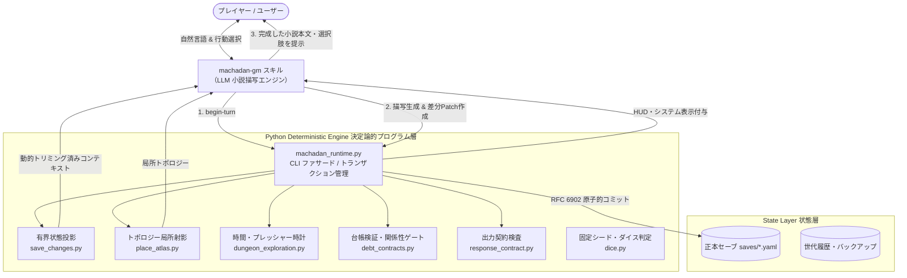

# 『マチャダン スペード MUSE版』包括的アーキテクチャ分析レポート
**〜「AIエージェントがGMとなってユーザーがTRPGを楽しむ」先人プロダクトの全貌と設計知見〜**

対象プロダクト：`machadan_muse_package`（バージョン `v4.13.4`）

---

## 1. エグゼクティブサマリー

『マチャダン スペード MUSE版』は、「AIエージェントをGM（ゲームマスター）としてプレイヤーに高品質なTRPG体験を提供する」という目的において、**AI（LLM）と決定論的プログラム（Python）のハイブリッドアーキテクチャ** を極限まで突き詰めた先駆的実装です。

AIにすべてを任せる（計算、記憶、判定、演出の全担当）のではなく、**「判定・計算・検証・空間管理・状態保持はすべて決定論的Pythonエンジンが担当し、LLMは確定事実を元にした純粋な文学的小説描写に100%特化する」** という設計思想が徹底されています。



---

## 2. アーキテクチャの真の実態（4層分離とモジュール構造）

本パッケージは単一の巨大スクリプトではなく、責務ごとに明確に分離された決定論的ドメインエンジン群から構成されています。

### レイヤー構成
1. **スキル層 (`workspace/skills/`)**:
   - `machadan-gm`: 日常のターン進行・演出・プロンプト注入に専念。
   - `machadan-doctor`: 導入、破損検証、正本照合、ロールバックを担当する保守専門エージェント。
2. **ツール層 (`machadan_spade/muse版/tools/`)**:
   - 各サブシステム（ダンジョン、負債・契約、舞台射影、状態投影、出力検査、ダイス、オンボーディング）がPythonモジュールとして完全分離。
3. **制御層・ナレッジ層 (`運用/`, `世界/`, `文章/`)**:
   - `決定台帳.yaml` (M1〜M108): 過去の仕様変更と失敗知見の記録。
   - `正本レジストリ.yaml`, `ルーティング表.yaml`: 17場面の動的注入定義。
   - `舞台構造.json`: 27拠点・304部屋の接続グラフ（SSOT）。
4. **状態層 (`saves/`, `state/`)**:
   - キャンペーン正本（YAML）、ターン作業領域（`runtime/`）、世代履歴（`_history/`）。

---

## 3. 核心技術①：有界状態投影（Bounded State Projections）
**長期キャンペーンでのコンテキストパンクを完全に防ぐ仕組み**（`save_changes.py`）

AI TRPGで最も頻発する「遊べば遊ぶほどセーブデータや過去ログが膨らみ、コンテキスト上限に達して破綻する」問題に対し、以下の3重フィルターを実装しています。

```
[セーブ正本 (巨大なYAML)]
       │
       ▼
 ┌────────────────────────────────────────────────────────┐
 │ 1. 場面特化の数値トリミング                               │
 │    日常・会話場面では base_stats, equipment_bonus 等の     │
 │    詳細な計算内訳を完全除去し、実効値のみ渡す。              │
 ├────────────────────────────────────────────────────────┤
 │ 2. 過去ログのポインタ化（Pointerization）                │
 │    直近6件のみ保持。長文の過去ログは文字数と             │
 │    「/session_log/previous」ポインタに要約。           │
 ├────────────────────────────────────────────────────────┤
 │ 3. campaign_lore の動的関連度フィルター                  │
 │    「現在の同行者」「現在地」「進行中クエスト」「未解決の約束」 │
 │    に合致するもの＋直近8件のみを動的抽出。               │
 └────────────────────────────────────────────────────────┘
       │
       ▼
 [LLMへ渡される最小限のプロンプト (常に数千トークン以内に収束)]
```

- **RFC 6902 JSON Pointerによる差分適用**:
  - LLMにはセーブ全体の再生成をさせず、`[{"op": "replace", "path": "/player/hp", "value": 15}]` のような差分のみを出力させます。
  - ルートの重要メタデータ（スキーマ、キャンペーンID、改訂番号等）への直接操作はPython側で例外を出してブロックします。

---

## 4. 核心技術②：プロンプト設計の進化史と「GM_BRAINの廃止」
**AIに考えさせながら出力させるアプローチの敗北と到達点**（`決定台帳.yaml` 改訂 `M81`）

### 失敗した初期アプローチ（思考ブロック）
初期バージョンでは、LLMに出力冒頭で ` ```GM_BRAIN ... ``` ` というコードブロックを出力させ、シーン分類やダイス計算を考えさせていました。
しかし、以下の3つの重大な欠陥により **M81で完全廃止** されました：
1. **没入感の破壊**: プレイヤーにAIの内部変数や英語の思考過程が生々しく見えてしまう。
2. **トークン浪費と遅延**: 毎ターン思考を出力するため生成速度が大幅に低下する。
3. **計算の非信頼性**: 思考ブロック内でLLMが計算しても、結局HP加減算やダイス判定でハルシネーション（計算ミス）を起こす。

### 洗練された最終形態
- **推論・判定・計算はすべてターン開始前の外部ツール（Python）で完結させる**。
- LLMには「確定した出目」「被ダメージ量」「現在のトポロジー」だけを入力として与える。
- LLMは **「確定した事実を最高の文学的筆致で描写すること」だけに100%の計算リソースとトークンを注ぎ込む**。

---

## 5. 核心技術③：ルードナラティブ・エンフォースメント（設定の機械強制）
**プロンプトのお願いに頼らず、台帳とステートマシンで縛る**

世界観やキャラクター設定の厳守を、プロンプトの指示文だけに依存すると、プレイヤーの巧みな誘導やLLMの気まぐれですぐに崩壊します。本作では以下をプログラムで機械強制しています：

### (1) 暗号学的台帳による関係性ロック（`debt_contracts.py`）
- ヒロイン（リリス）との恋愛・親密展開は、初期借金（10,000G）の返済履歴台帳（`collection_ledger`）を先頭から検算し、正当な完済レシートが存在しない限り、**セーブデータへの親密ステータス書き込みをバリデータが実行時例外で拒絶** します。
- プロンプトにも `runtime_cast_rules` により「初回完済前。口説き・CHM・好感度でも絶対になびかず、隠れた好意を漏らさない」という制約が動的注入されます。

### (2) ダンジョン探索の決定論的ステートマシン（`dungeon_exploration.py`）
- **時間帯（朝・昼・夕・夜）**: 階層移動3回で1段階進行。
- **プレッシャー時計（0〜6）**: 行動ごとに加算され、`6` で強制ボス遭遇。LLMには「数字を言わず、足音や気配の描写に変換せよ」と指示。
- **徘徊モンスター襲来（Incursions）**: 同一階層への長居で下層の強敵が自動出現。
- **ボスの実の天井（Pity System）**: 3回連続ドロップ失敗で次回確定の擬似乱数セーフティネット。

### (3) トポロジー局所射影（`place_atlas.py`）
- 街全体の広大なマップを渡すと空間破綻（勝手に部屋を生やす、ワープ移動）を起こすため、**「現在いる部屋と、直接扉や階段で繋がっている隣接区画」** だけを局所スライスしてLLMに提示。未施錠の扉しか通れないルールを強制。

---

## 6. 核心技術④：出力契約検査（Response Contract）
**プレイヤー体験の品質を保証するバリデーション**（`response_contract.py`）

LLMからの返信は、以下の独立構造を持つJSONとして受け取り、厳密に検査されます：
1. `main_text`（純粋な地の文とセリフ）:
   - Markdownコードブロックの混入を禁止。
   - 装飾記号（`*`, `#`, `>`）や空白を除去した **純粋な可視文字数** で文字数枠（例: 600〜800文字）を機械判定。
2. `system_blocks`（ダイス結果、ステータス変動、収支内訳の配列）:
   - プレイヤーが状況を把握しやすいよう、物語本文とは分離して整形表示。
3. `choices`（行動候補配列）:
   - LLMには純粋な文字列配列を出力させ、ランタイム側で `1. `, `2. ` の連番と末尾の `自由入力もできます。` を自動結合。

---

## 7. 我々の新プロダクトが参考にすべきベストプラクティスと現代的進化

本プロダクトの優れた設計パターンを、現代の技術スタック（Gemini 2.0 / Next.js / Discord / SQLite等）で再構築する際のロードマップです。

| 『マチャダン』の設計パターン | 理由・メリット | 我々のプロダクトでの現代的実装案 |
|---|---|---|
| **外部決定論的エンジン** | LLMの計算ミス・ハルシネーションを根絶 | **Gemini Tool Calling / Function Calling ネイティブ**<br/>判定・ダイス・所持金・HP計算をツール呼び出しで実行。 |
| **有界状態投影 (Bounded Projection)** | ターン数が増えてもコンテキストがパンクしない | **SQLite + ベクトル検索 / 場面別クエリ**<br/>現在地・同伴NPC・直近イベントのみをプロンプトへ動的注入。 |
| **JSON Pointer差分更新** | セーブ全体の再生成による破壊・データ喪失を防止 | **Structured Outputs (JSON Schema)** または **Tool Calling 引数での差分送信**。 |
| **トポロジー局所射影** | 空間の勝手な捏造・ワープを防止 | **Graphviz / NetworkX 型のノード接続グラフ**<br/>現在地ノードとその隣接エッジのみをコンテキストに提示。 |
| **出力契約（本文/システム/選択肢の分離）** | 没入感の維持とゲーム的UIの両立 | **フロントエンドUIとのコンポーネント分離**<br/>本文、ダイスHUD、選択肢ボタン（Discord ActionRow / Web UIボタン）に独立描画。 |
| **GMとDoctorの役割分業** | エラー時のゲーム破壊・データ破損を防止 | **メイン進行エージェントとリカバリー/管理エージェントの明確な分離**。 |

---

## 8. 次のアクション（検討・決定事項）

1. **プラットフォーム・UI形式の決定**:
   - Webアプリ（Next.js + Generative UI）か、Discord Bot形式か、CLI/デスクトップ形式か。
2. **TRPGのルール体系・世界観の策定**:
   - 独自ファンタジー、サイバーパンク、現代伝奇、あるいはクトゥルフ風など。
   - ダイス判定方式（d100上方/下方、d20、ダイスプール等）。
3. **最小プロトタイプ（MVP）の設計着手**:
   - まず「キャラクター作成 → 街での探索 → 簡単なダイス判定と戦闘 → セーブ差分更新」が動く最小ループの仕様策定。
