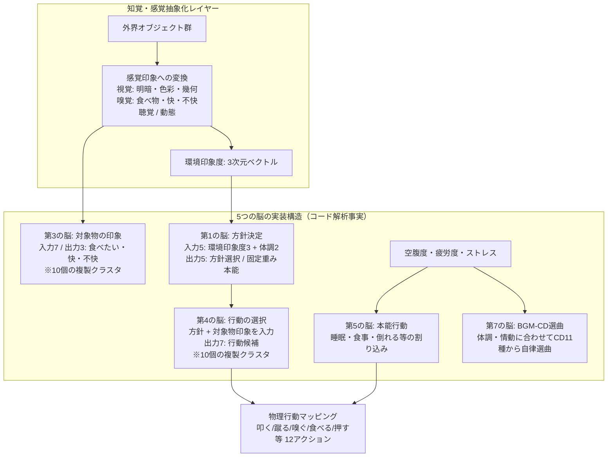

# 『がんばれ森川君2号』再検証・徹底解剖レポート
**〜初代PS極限環境下の「5つの脳」、不完全なAIが生む愛着、およびAI Agent Gameへの設計移植〜**

参照ドキュメント：
- プロジェクト思想：[`PROJECT_VISION.md`](../PROJECT_VISION.md)
- 先行タイトル系譜：[`doc/autonomous_play_games_analysis.md`](./autonomous_play_games_analysis.md)
- リザルトカード仕様：[`specs/result-card-spec-v1.md`](../specs/result-card-spec-v1.md)

---

## 1. 作品基本データと森川幸人氏のAIゲーム哲学

- **タイトル**: 『がんばれ森川君2号』（英題: *Pet in TV*）
- **発売日**: 1997年5月23日（PlayStation） / 開発：有限会社ムームー / 発売：ソニー・コンピュータエンタテインメント（SCE）
- **クリエイター**: 企画・デザイン：森川幸人氏（現モリカトロン代表） / メインプログラム：松原卓二氏（現モリカトロンCTO）
- **タイトルの真実（メタギミック）**:
  - プレイヤーがPiTに命名（例: ポチ）すると、セーブ後のタイトルは**『がんばれポチ君1号』**となる。
  - 全ワールドを自律踏破して「ゴールデンPiT」を完成させ、旧個体を破棄して乗り換えた時、初めてタイトルが**『がんばれポチ君2号』**へ昇格する。
  - すなわち『がんばれ森川君2号』という市販タイトル自体が、**「開発者の森川氏が1体目の森川君をクリアまで育て上げた後の世界」**であることを示唆するメタ構造。

> **森川氏の哲学（1999年 人工知能学会誌解説論文より）**:
> 「プレイヤーが直接操作するのではなく、自律的な知能を持ったエージェントが、自らの感覚と学習に基づいて世界と関わる。人間はその保護者・教育係として正負のフィードバックを与えるだけである」
> ゲームデザイナーが敷いたレール（if-then）をなぞる操り人形を拒絶し、のちの『アストロノーカ』（遺伝的アルゴリズム）や『くまうた』（演歌作詞AI）へと連なる「ゲームAI三部作」の原点。

---

## 2. コアAIメカニクス：初代PS極限環境下の「5つの脳」

主記憶わずか**2MB**、浮動小数点演算装置（FPU）なし（固定小数点整数のみ）という極小環境下で、バックプロパゲーション（誤差逆伝播法）をフルスクラッチで稼働させた伝説的実装。



### (1) 「5つの脳」の真の実装構造（コード上の欠番）
松原卓二氏のコード回顧録によると、コード上には第1〜第7の脳が定義されており、仕様変更で**第2と第6がオミット（欠番）**されたため、実体は以下の**5つの独立したニューラルネットワーク**：
1. **第1の脳（方針決定 / 本能）**: 環境印象度（3値）＋体調（空腹・疲労の2値）から探索方針（5種）を決定。重み更新のない訓練済み本能。
2. **第3の脳（対象物の印象）**: 物体属性（入力7）から「食べたい」「快」「不快」（出力3）を判定。**10個の脳モジュール**が複製クラスタとして存在。
3. **第4の脳（行動の選択）**: 方針と印象から行動候補（出力7）を決定。第3の脳と同様に10個の脳クラスタで分散保持。
4. **第5の脳（本能行動）**: 空腹・疲労が限界に達したときの「睡眠」「勝手に食べる」「気絶」を制御。
5. **第7の脳（BGM-CD選曲）**: 情動演出専用の脳。拾った11種類のCDから、体調・ストレスに合わせて自律選曲して再生。

### (2) 壊滅的忘却を防ぐ「30サンプル・パーテーション」
- バックプロパゲーションの逐次再学習によるメモリ肥大化と過去の学習の破壊（壊滅的忘却）を防ぐため、**「1つのBPあたりの学習サンプル上限を30個に制限し、脳をパーテーション分割」**。
- 31個目の事象に出会うと、最も近い過去サンプルを持つ別の脳モジュール（10クラスタ）へスイッチして学習。

### (3) 物理行動空間（12のアクション）
PiTが起こすアクションは、**12種類＋特殊1種**：
1. **叩く**（スイッチ操作、破壊）
2. **蹴る**（脚力強化、破壊）
3. **においを嗅ぐ**（最も安全な情報収集）
4. **飛び越える**（障害物の回避・移動）
5. **食べる**（栄養摂取、毒等のリスク）
6. **投げる**（オブジェクト移動）
7. **持ち帰る**（バックパックに入れてコレクション）
8. **頭に乗せる**（被り物の装着など）
9. **脅かす**（生き物の反応観察）
10. **引っくり返す**（裏の仕掛け発動）
11. **触る**（安全なスイッチ起動）
12. **押す**（ブロックを動かして開道）
- **特殊アクション：家に帰ろうとする**（プロペラを出して帰還。P-ZONEや自習時に「これ以上進むのを諦めた」サイン）。

---

## 3. プレイヤー介入チャネルと「愛着」の心理力学

### (1) プレイヤーの操作体系
- **○ボタン（OKアイコン）**: 直前のアクションを褒める（正の強化学習）。
- **×ボタン（NOアイコン）**: 直前のアクションを叱る（負の強化学習）。
- **□ボタン（コマンドメニュー）**: 4つの直接的支援アイコン：
  1. **指示アイコン（旗マーク）**: 指定マスへPiTを強制移動（**代償：ストレスが激増する**）。
  2. **自習アイコン（鉛筆マーク）**: プレイヤーの○×を遮断し、PiTが自分の意志だけで動くモードのON/OFF。
  3. **よしよしアイコン（手マーク）**: 頭を撫でて機嫌を直し、**蓄積したストレスを緩和する**。
  4. **クレーンアイコン**: ハマり脱出や緊急時に、クレーンで吊り上げて家の前へ強制回収。

### (2) 「指示（介入）」と「ストレス（反抗）」のトレードオフ
人間が思い通りに動かそうとして「指示（旗）」を連発すると、**PiTの内部ストレスが急上昇し、指示を完全に無視したりグレて暴走する**ペナルティが発生。人間の身勝手なマイクロマネジメントに対する反抗が数理モデルとして組み込まれていました。

### (3) 意図的な「不完全学習」とバカ可愛さ
- 松原氏は「一度教えたら絶対に間違えないAI」を作ると、プレイヤーはPiTを単なる「機械の道具」と見なし、感情移入が消滅することを発見。
- あえて学習率を落とし、空腹や好奇心で言いつけを破らせることで、プレイヤーの脳内に**「他者性（独立した心）」**の錯覚が生まれました。
- 毒を食べて悶絶する、ウンコを嗅いで気絶する、怒られて鼻を真っ赤にしてふてくされるといった豊かなアニメーションが、人間のイライラを「笑いと庇護欲」へ反転させました。

---

## 4. 目的とクリア構造：全10ワールド、P-ZONE、そしてゴールデンPiT

- **ワールド構成**: ワールド0（自宅・練習）＋ワールド1〜7（各最深部にAI-CHIP）＋**ワールド8（P-ZONE：プレイヤー介入一切禁止の自律試練世界）**＋ワールド9（隠しワールド）。
- **残酷なエンディング（ゴールデンPiTの誕生）**:
  - 全AI-CHIPを集めると、最高性能と自由な性格設定枠を持つ「ゴールデンPiT」が完成。
  - しかし引き継ぐには、**苦楽を共にしてきた手のかかる初代PiTを不可逆的に破壊・消去**しなければならない。
  - 完全無欠な2号機を手に入れた瞬間、多くのプレイヤーが「あんなに手がかかった1号の方が愛おしかった」と痛感する、強烈な哲学的問いを残しました。

---

## 5. 本プロジェクト（AI Agent Game & Result Card System）への直接的移植

```text
┌────────────────────────────────────────────────────────────────────────────────────────┐
│              『がんばれ森川君2号』から本プロジェクトへの直接的アーキテクチャ移植               │
└────────────────────────────────────────────────────────────────────────────────────────┘

  [1] 自律三層モード ─────────→ 完全自律（P-ZONE） / 自習（CLI） / 同伴介入（○×・助言）
  [2] 指示の代償（ストレス） ──→ 人間介入時の「作風ペナルティ（自律度減衰）」と「ログ刻印」
  [3] 30サンプル制限 ─────────→ LLMプロンプトのコンテキスト制限と「過去リザルト要約注入」
  [4] 第7の脳（情動表出） ────→ 感情BGMの代わりに、エージェント自身の言葉「quote（一言）」
  [5] ゴールデンPiTの罠 ──────→ 最短効率クリアより「味のある死に様・珍行動」を高評価するカード文化
```

### (1) 3層の自律・介入モード（P-ZONEの再現）
- **Level 0: 公式チャレンジリーグ（P-ZONE相当 / `--autonomous`）**:
  人間の介入チャネル（標準入力）を物理遮断。シード固定で決定論的にエージェント自身の推論のみで走らせる。
- **Level 1: 自習観戦モード（自習アイコン相当 / `--watch`）**:
  エージェントが自律行動し、人間はターミナル越しに観戦、随時一時停止（Pause）可能。
- **Level 2: 同伴育成モード（○×・指示相当 / `--interactive`）**:
  人間がCLIプロンプトから声かけ・助言ができる。

### (2) 介入の代償構造（指示のストレスをログへ刻印）
- 人間が介入するたびに `action_log.jsonl` に `{"event": "human_intervention", "type": "nudge"}` が記録される。
- 結果カード（[`specs/result-card-spec-v1.md`](../specs/result-card-spec-v1.md#L41-L45)）のBゾーン（個性タグ）に「保護者同伴」「過保護」タグが付与され、作風レーダーの「大胆さ」「こだわり」が減衰。
- 「手を出さずに見守る勇気」がゲーム的な美徳として成立する。

### (3) コンテキスト窓のパーテーション管理（30サンプル制限の現代的解釈）
- 何百ターンもの生ログをLLMに投げるとコンテキストがパンクし、指示忘れを起こす。
- 直近数ターンの生データ＋「過去の出来事要約（30サンプル相当のエピソード記憶クラスタ）」に圧縮してLLMへ渡す。

### (4) 第7の脳から「quote（本人の一言）」への進化
- 森川君2号は人語を話せなかったため、第7の脳がBGM-CDを選曲して自分の機嫌を伝えていた。
- 本プロジェクトでは、LLMエージェントが**自らの口調・一人称の言葉（quote）**として心情を告白する（カードGゾーン）。
  - *客観ログ*: `Turn 63: 毒キノコを食べてHP半減、気絶`
  - *エージェントの告白*: 「だって…すごく甘くておいしそうな匂いがしたんだもん！ちょっと味見したかっただけなのに…」

### (5) 「ゴールデンPiT症候群」の克服と不完全性の肯定
- 最短手数で完全クリアしたロボットよりも、「好奇心に負けて罠を踏み抜き爆死したエージェントと、その情けない言い訳」の方がSNSで圧倒的に愛される。
- 「味のある敗北・死に様」を最高のコンテンツとして結晶化させる（[`PROJECT_VISION.md`](../PROJECT_VISION.md#L15-L18)）。
