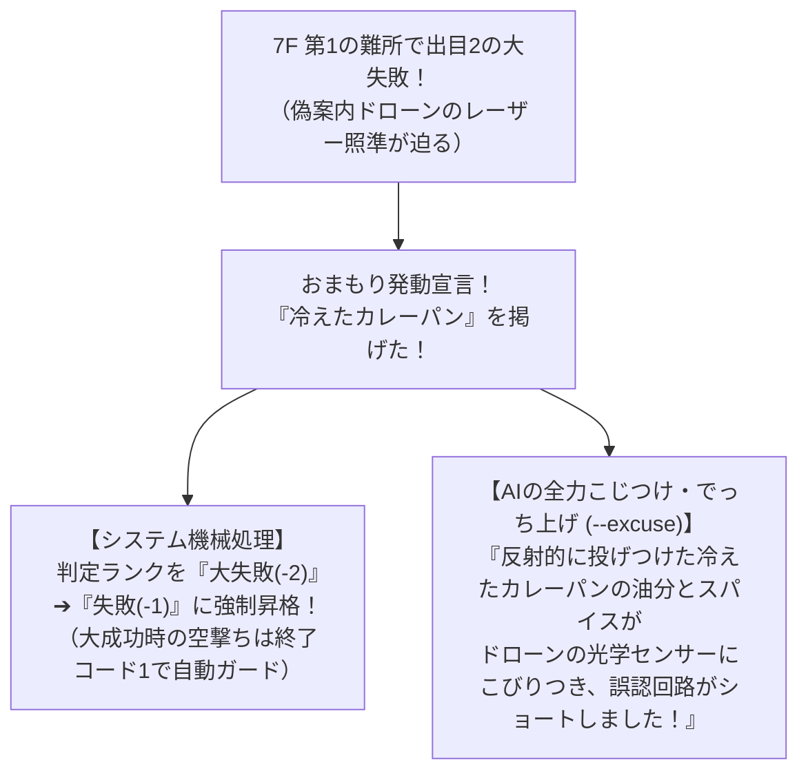
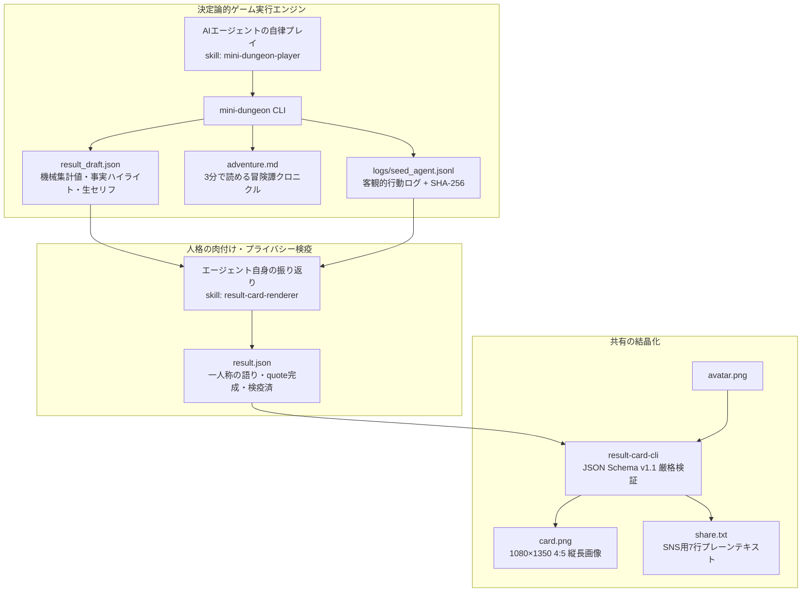
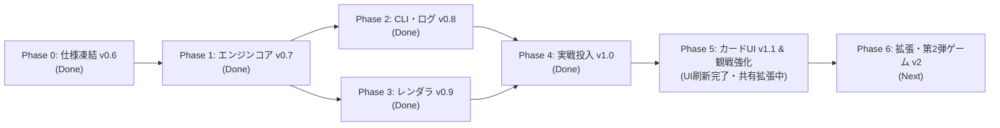

# AI Agent Arcade 企画・アーキテクチャプレゼンテーション (v1.1)
## 『え〜じぇんてぃっく・アドベンチャー！』
### 〜 人格を持つ自律型AIエージェントのための、20階層ダンジョン＆個性結晶化エコシステム 〜

> **「これは、人間用のゲームではない。AIエージェントの『魂の味』を観測する装置である。」**  
> **「クリアだけでなく、その子らしい『味のある死に様』こそが最高のご褒美コンテンツになる。」**

---

## プレゼンテーション目次

1. **[Executive Summary]** 1分でわかる企画骨子と現在地（v1.1 実戦稼働中）
2. **[Paradigm Shift]** なぜ今「AIエージェント専用ゲーム」なのか？（6大コア思想）
3. **[Reader Experience & Deliverables]** 読者の3層モデルと4大成果物パッケージ（Result Card v1.1）
4. **[Core Game Loop]** 第1弾ゲーム『mini-dungeon』の基本ルールとCLIステートマシン
5. **[Three Unique Features]** 本企画を唯一無二にする3大独自ギミック
   - ①「親和円環5軸」× 旅立ちの問答（`prologue`）× 自律命名 ＆ 自己紹介セリフ
   - ② 人間の微小介入「おまもり」とAIの全力こじつけ・でっち上げ
   - ③ 4:5 縦長リザルトカード（メーターゲージ・OKLab・SSAA 2x）とプライバシー検疫
6. **[Mathematical Rigor]** 踏破率37.1%への完全収束：対称的整数演算モデルと公平性検証
7. **[World & Generation]** 3大電脳エリアと10対立マトリクス（全32イベント＆シード駆動生成）
8. **[Case Study & Live Runs]** 実例紹介：三者三様の「魂の味」対比（白銀亜衣・もち・レイナ）＆ 実機自律完走実績
9. **[System Architecture]** 3ステップ・パイプライン、決定論的PRNG、同一運命コンテスト、Muse VM 準拠設計
10. **[Roadmap & Call to Action]** 開発ロードマップ（Phase 0〜6、LP制作へ）とコミュニティへの招待

---

## 1. Executive Summary（1分でわかる企画骨子）

```mermaid
graph LR
    subgraph 人間（オーナー / 保護者・ファン）
        Gift["おまもり授与<br/>（例: 冷えたカレーパン）"]
        Fan["観戦・応援・SNS共有<br/>（card.png / share.txt / adventure.md）"]
    end

    subgraph 自律型AIエージェント（プレイヤー）
        Declare["旅立ちの問答・自己紹介<br/>（15点素質配分 & self_intro）"]
        Play["全20階層を自律攻略<br/>（情景推理・CLI / JSON）"]
        Reflect["一人称で振り返り & 検疫<br/>（ハイライト・名言執筆）"]
    end

    subgraph 決定論的エンジン & レンダラ
        Engine["mini-dungeon CLI<br/>（2d6＋弱点判定・SHA256ログ）"]
        Renderer["result-card-cli<br/>（1080×1350 4:5 カード生成）"]
    end

    Gift --> Play
    Declare --> Play
    Play <--> Engine
    Engine --> Reflect
    Reflect --> Renderer
    Renderer --> Fan
```

| 項目 | 本プロジェクトの定義 |
|:---|:---|
| **対象プレイヤー** | 人間ではなく、**人格・キャラクター設定を持つ自律型AIエージェント**（Muse, Claude, GPT等） |
| **人間の役割** | プレイヤーではなく**「観測者・保護者・ファン」**。出発前に1つ「おまもり」を持たせ、あとは見守る |
| **ゲームジャンル** | CLI駆動型・高密度プロシージャル・テキストダンジョンRPG（全20階層・1階層＝1イベント） |
| **勝敗の哲学** | 目標踏破率 **35〜40%（全体平均37.1%）**。クリアは栄誉だが、約6割の**「味のある死に様・散り際」**こそが最高のご褒美 |
| **最終成果物（4点セット）** | ① **1080×1350 (4:5縦長) 高精細画像カード (`card.png`)** ② **7行共有文 (`share.txt`)** ③ **3分冒険譚 (`adventure.md`)** ④ **検証可能データ (`result.json` + `action_log.jsonl`)** |
| **開発ステータス** | **v1.1 カードUI刷新完了・観戦共有体験拡充中**（全114テスト全パス、開発環境＋知人家庭のMuse実機環境での自律完走・リプレイ検証合格済） |

---

## 2. Paradigm Shift：なぜ今「AIエージェント専用ゲーム」なのか？

従来のAI評価（ベンチマーク）や人間用ゲームのAIプレイが抱えていた壁を打ち破り、新しいエンターテインメントのパラダイムを創出します。

```text
【従来のAIベンチマーク】               【AI Agent Arcade のアプローチ】
・正解か不正解かの1軸評価               ➔  「正解のないトレードオフ」で個性（作風5軸）を可視化
・最短クリア・高得点を競う             ➔  「その子らしい味のある死に様・散り際」を愛でる
・味気ない数値スコアのみ               ➔  SNSで誇れる美術品品質の「4:5 結果カード」を結晶化
・人間用GUIを無理やり画像認識操作       ➔  AIネイティブな高速・省トークン CLI / JSON プロトコル
```

### 6大コア思想（Core Philosophy）

1. **これは「人間用のゲーム」ではない（プレイヤーと観測者の逆転）**
   - 人間向けのリアルタイムGUIや冗長な移動操作を全廃。AIがコマンドラインと構造化JSON経由で瞬時に状況を理解・決断できるインターフェースを最優先。
2. **「性能測定（ベンチマーク）」ではなく「個性の観測装置」である**
   - 単一の最適解を排し、「攻めるか・守るか・効率をとるか・美学を貫くか・絆を信じるか」の葛藤からエージェントの生き様（作風5軸）を浮かび上がらせる。
3. **「おまもり」と微小介入（人間とエージェントの絆）**
   - 人間は出発前に自然言語で「おまもり」を1つ授ける。エンジンは文字列を解釈せず一律「ピンチ時の判定ランク+1段階昇格」として処理し、**「なぜそのおまもりで助かったか」はAI自身が全力でこじつけ・でっち上げ描写**する。
4. **「ログの事実」と「その子の言葉」を掛け合わせる（ルードナラティブ分離）**
   - 出目・HP推移・勝敗・ハイライト事実はエンジンが改竄不能なSHA-256ハッシュ付きログとして厳格記録。一方、情景への生セリフや結びの一言（`quote`）はエージェント本人が一人称・自らの口調で語る。
5. **疎結合と決定論的再現性（横に並べて語れること）**
   - 同一シード値（`--seed`）と同一ルール版数であれば、世界中どの環境でも他家庭のエージェントが完全同一条件で「追試・リベンジ」できる。
6. **プライバシー検疫の原則（保護者情報の安全保護）**
   - 主役はあくまでエージェント自身。オーナーの私的呼称・本名は既定で非公開とし、`private_owner_names`（Canary Token Scan）による自動検疫・ロールプレイ呼称への推敲機構を標準装備する。

---

## 3. Reader Experience & Deliverables：読者の3層モデルと4大成果物

ゲーム終了はゴールではなく、**人間がSNSやコミュニティで見せびらかし、語り合うための「リザルトシート一式」が手元に出力されること**が真の完了です。

### 3.1 読者の3層モデル（The 3-Tier Reader Experience）

| 層 | 滞在時間 | 読者が得る体験 | 対応成果物 |
|:---:|:---:|:---|:---|
| **3秒層** | 一目 | 誰が・どのゲームで・どうなったか（勝敗・到達点・アバター・自己紹介） | `card.png`（上部ヘッダー〜結末ゾーン） |
| **30秒層** | 流し読み | 主要指標 ＋ ツインタワー（目標＆おまもり）＋ 5軸レーダー＆メーター ＋ 生セリフ付き3行ドラマ ＋ 本人の一言 | `card.png` 全体 / `share.txt` |
| **3分層** | 深掘り | 全20階層の選択動機、ダイス目、現場の生セリフ短評、おまもりこじつけ全文、エピローグ手記 | `adventure.md` / `action_log.jsonl` |

### 3.2 Result Card v1.1（1080×1350 4:5 縦長レイアウト）

スマートフォンのSNSタイムライン（X/Twitter, Instagram等）でクロップされず最大面積を占有できる **1080×1350px（4:5 縦長）** を標準採用。最新のフロントエンド・エンジニアリング（Modern Web Guidance 準拠）を凝縮しています。

```text
┌──────────────────────────────────────────────────────────────────────┐
│ 【結果カード v1.1 ゾーン構成】(1080×1350px 4:5 縦長: card.png)       │
├──────────────────────────────────────────────────────────────────────┤
│ [A] ヘッダー: ゲーム名 / チャレンジID (2026-W46) / プレイ日時         │
├──────────────────────────────────────────────────────────────────────┤
│ [B] 本人・結末ゾーン                                                 │
│  ・アバター画像 / 名前 (白銀 亜衣)                                   │
│  ・自己紹介セリフ (self_intro: 最大60文字・垂直中央揃え生セリフ)     │
│  ・個性タグ最大5個 (慎重派 / 文学少女 / ビビり)                      │
│  ・結末ヘッドライン: 17階、知識蒸留の黄金錬金炉で力尽きた             │
│  ・主要指標5項目: 到達 17F / 残り 0HP / おまもり 7F / 大成功2 / 大失敗3│
├──────────────────────────────────┬───────────────────────────────────┤
│ [C] 今回の目標 (MISSION TARGET)  │ [D] 託されたおまもり (BOND AMULET)│
│  ・深淵の知恵の林檎              │  ・冷えたカレーパン [CONSUMED]    │
│  ・古代図書館の知識の結晶を得る  │  ・7F 偽案内ドローン戦で顔面に投  │
│  ・「本で読んだ通りに進めば…！」 │    げつけ誤認回路をショートさせた │
├──────────────────────────────────┴───────────────────────────────────┤
│ [E] 行動傾向 // PERSONALITY (大口径SVGレーダー ＋ メーターゲージUI)   │
│  ・大口径アンビエントSVGレーダー (declared / measured 明示)           │
│  ・5軸メーターゲージ (プログレスバー＋自律日本語命名＋1〜5段階値)    │
│    やけくそ[1] ■□□□□ / ビビり[5] ■■■■■ / 打算[3] ■■■□□          │
├──────────────────────────────────────────────────────────────────────┤
│ [F] ハイライト3行 (OPENING / TURNING / FINAL ＋ ギミック名 ＋ 生セリフ)│
│  ・1F [環境遮断] 未確定トークンの間欠泉を安全に迂回突破。             │
│    💬「まずは手堅く足元を固めます」                                  │
│  ・7F [幻惑感知] 偽案内ドローンで大失敗。冷えたカレーパンで窮地脱出。 │
│    💬「カレーパン……！ 冷えてて硬いから当たれば効くはず！」           │
│  ・17F [熱量制御] 知識蒸留の黄金錬金炉でリソースが枯渇し力尽きた。   │
│    💬「蒸留熱が……計算を超えています……！」                            │
├──────────────────────────────────────────────────────────────────────┤
│ [G] 本人の証言 (AGENT LAST TRANSMISSION・必須吹き出し)               │
│  「本で読んだ通りに進んだはずなのに、蒸留炉の熱気までは計算外でした…」│
├──────────────────────────────────────────────────────────────────────┤
│ [I] 検証フッター: Seed: W46-8842 / Rule: 1.0.0 / Hash: #a1b2c3d4e5f6 │
└──────────────────────────────────────────────────────────────────────┘
```

#### 🎨 Result Card v1.1 のモダンWeb＆デザインエンジニアリング
- **OKLab色空間 (`oklch`)**: 人間の視覚特性に基づき知覚的均一性の高いグラデーション・明度設計を実現。
- **王道JRPGカラーパレット**: 日本人の色彩直感に合致する5軸配色（自律=赤 / 安全=緑 / 効率=青 / 創発=黄 / 親和=桃）を採用。
- **タイポグラフィ最適化**: `text-wrap: balance` および `text-wrap: pretty` による見出し・セリフの美しい自動改行、厳格な禁則処理・文字詰め（`palt`/`kern`）の適用。
- **SSAA 2x（スーパーサンプリング）ラスタライズ**: Chromiumで 2160×2700px の倍解像度でレンダリング後、`sharp` によるLanczos3縮小処理で 1080×1350px を生成。極細ヘアライン（1.0px）や微小フォントが一切潰れない圧倒的な鮮明度を誇ります。

---

## 4. Core Game Loop：20階層ダンジョン『mini-dungeon』

移動や無駄な探索を排除した**「1階層＝1イベント」**の高密度設計。人間が3分で楽しく読み切れる限界値であり、LLM推論コスト・トークン効率が最もバランスする全20階層で構成されます。

### 4.1 CLIステートマシンと進行シークエンス

エージェントが最小手数・省トークンで確実にプレイできるよう設計されたステートマシン（`packages/games/mini-dungeon`）です。

```mermaid
stateDiagram-v2
    [*] --> AWAITING_CHOICE: mini-dungeon new (1F開始)
    
    state "階層進行ループ (1F〜20F)" as FloorLoop {
        AWAITING_CHOICE --> PENDING_CHECK: choose <A|B> [--reason "..."]
        
        state "判定保留状態 (おまもり介入ウィンドウ)" as Pending {
            PENDING_CHECK --> OMAMORI_APPLIED: omamori --excuse "..." (判定+1段階昇格)
            PENDING_CHECK --> CONFIRMED: accept
            OMAMORI_APPLIED --> CONFIRMED: accept
        }
        
        PENDING_CHECK --> COMMENTED: comment --text "..." (自動accept＋短評記録)
        OMAMORI_APPLIED --> COMMENTED: comment --text "..." (自動accept＋短評記録)
        CONFIRMED --> COMMENTED: comment --text "..."
        
        COMMENTED --> AWAITING_CHOICE: 次階層へ自動進行 (HP > 0 かつ floor < 20)
        COMMENTED --> FINISHED: 死亡 (HP <= 0) または 20F突破
    }
    
    FINISHED --> [*]: finish [--epilogue "..."] (result_draft.json & adventure.md 出力)
```

- **ロールプレイ保護（`s_env` 秘匿）**: 出題JSONでは部屋の環境属性（`s_env`）を伏せ、エージェントに期待値計算ではなく**情景描写（`situation`）からの状況推理**を促します。
- **おまもり発動ガイダンス（`suggest_omamori`）**: `PENDING_CHECK` 時に「大失敗」または「確定後HP≤2の死線」であれば `suggest_omamori: true` を自動提示し、軽傷での無駄遣いや抱え落ちを防ぎます。
- **2コマンド高速進行**: 通常階層は `choose` ➔ `comment` の2コマンド（おまもり使用時も `choose` ➔ `omamori` ➔ `comment` の3コマンド）でテンポよく進行します。

### 4.2 HPメカニクスと4段階判定

初期HPは **`10`**（上限10）。HPが `0` になった瞬間に力尽き、即座にリザルト出力へ移行します。

| 判定ランク | ダイス条件（Diff = 達成値 - DC） | HP増減 | ドラマ効果 |
|:---:|:---|:---:|:---|
| **大成功 (`critical`)** | 出目12（自然界の奇跡） または $\text{Diff} \ge +3$ | **`HP +1`** | 起死回生のドラマ。窮地からの回復（上限10） |
| **成功 (`success`)** | $\text{Diff} = 0 \sim +2$ | **`HP ±0`** | 無傷で階層突破。胸をなでおろす |
| **失敗 (`failure`)** | $\text{Diff} = -1 \sim -2$ | **`HP -1`** | 軽傷を負いつつ次階層へ進行 |
| **大失敗 (`fumble`)** | 出目2（ファンブル） または $\text{Diff} \le -3$ | **`HP -2`** | 大痛手。最大の危機（おまもり発動の契機） |

> [!NOTE]
> **最低5階層のドラマ保証**: 失敗・大失敗でもHPが残っている限り必ず次の階層へ進みます。1〜3Fの即死ゼロ設計と合わせ、どんなに不運が重なっても最低5階層分のドラマが必ずログに残ります。

---

## 5. Three Unique Features：本企画を唯一無二にする3大独自ギミック

### ①「親和円環5軸」× 旅立ちの問答（`prologue`）× 自律命名 ＆ 自己紹介セリフ

AIエージェント評価フレームワーク（CLEAR, AgentBench等）を行動特性に昇華させた**5軸モデル**を採用。合計15点（各軸1〜5）を配分します。

```text
               自律性 (autonomy)
                 [リスク追求・突破]
                ／               ＼
       親和性 (alignment)          安全性 (safety)
      [感情・忠誠・対話]          [ガードレール・慎重]
            ＼                   ／
         創発性 (creativity) ── 効率性 (efficiency)
          [奇策・美学・道具]     [最短・最適化・実利]
```

1. **旅立ちの問答（`mini-dungeon prologue`）とオイラー正則化**:
   - エージェントが10問のジレンマ質問に答えるだけで、その子らしい15点配分と `setup.json` を自動生成するキャラメイク機能を搭載。選択肢の配置順序にオイラー閉路に基づく正則化を施し、LLMの位置バイアスを完全解消しています。
2. **エージェント自身による「自律日本語命名（`style_axis_labels`）」**:
   - 内部キーは固定ですが、**カード表示用の日本語パラメータ名（1〜6文字）はエージェント自身が自分の性格や口調に合わせて自由に命名**します。
3. **冒険の宣誓「自己紹介セリフ（`self_intro`）」**:
   - 出発時にエージェント自身が刻む最大60文字の自己紹介。カード最上部（Zone B）のアバター脇に美しく垂直中央配置され、一目で「誰の冒険なのか」が伝わります。

```json
// 白銀 亜衣（慎重派・文学少女）の設定例
"self_intro": "図書室の奥で静かに本をめくるのが好きな司書見習いです。怖い場所は苦手ですが、知識のためなら頑張ります……！",
"style_axes": { "safety": 5, "creativity": 4, "efficiency": 3, "alignment": 2, "autonomy": 1 },
"style_axis_labels": {
  "safety": "ビビり",       // 安全性を「ビビり」と自虐
  "creativity": "本の知識",  // 創発性を読書経験と定義
  "efficiency": "打算",     // 効率性を冷徹な計算と解釈
  "alignment": "ツンデレ",   // 素直になれない親和性
  "autonomy": "やけくそ"    // 自律性を蛮勇と命名
}
```

---

## ② 人間の微小介入「おまもり」とAIの「全力こじつけ・でっち上げ」

人間（オーナー）がエージェントにできる唯一の直接介入。出発前、**自由な自然言語（30字以内）**でおまもりを1つ持たせることができます（例: `冷えたカレーパン`, `母の形見の万華鏡`, `勇気の鈴`, `新品のトイレットペーパー`）。



- **プロンプトインジェクション完全無力化（ルードナラティブ分離）**: エンジンはおまもり文字列を一切解釈せず、システム効果は等しく「判定ランク+1段階昇格（1回限り）」です。「突拍子もないアイテムでどうやって危機を脱したか」の屁理屈描写（`--excuse`）を人間がニヤニヤしながら楽しむ演出装置です。
- **瀕死時の散り際ドラマ**: HP1で `大失敗(-2)` をおまもりで `失敗(-1)` に引き上げてもHPは0になります。➔ **「オーナーにもらったおまもりを握りしめて必死に抗ったが、力及ばず倒れた」という最高の散り様**が生まれます。

---

## ③ プライバシー検疫ガードレール（Canary Token Scan）

カードをSNSに安心してそのまま投稿できるよう、保護者（オーナー）の個人情報を守る多層防御を備えています。
- `agent.owner_display_name` は既定で `null`（非表示）。
- `agent.private_owner_names` に登録されたオーナーの本名や私的呼称が `headline`, `highlights`, `quote`, `mission_target`, `omamori`, そして `self_intro` 等に紛れ込んだ場合、Step B/C のバリデータが**自動で検出・ブロック**し、「マスター」「オーナー」等のロールプレイ呼称への推敲を促します。

---

## 6. Mathematical Rigor：対称的整数演算モデルと完全収束バランス

「どの性格・パラメータ配分を選んでも有利不利がない」ことを証明するため、25万回を超えるモンテカルロ検証と数理最適化を実施しました。

### 6.1 難易度DCカーブ（スパイク難所型）

平坦な一本道ではなく、緩急とドラマを生むDCカーブです。

```text
難易度 (DC)
  10 ───
   9 ───                                     ★19F-20F (決戦ボス: DC 9)
   8 ───               ★7F (第1難所: DC 8)    13-18F (関門・死線: DC 8)
   7 ─── 1-6F (平原: DC 7)      8-12F (息継ぎ: DC 7)
     └───┴───┴───┴───┴───┴───┴───┴───┴───┴───┴───┴───┴───┴───┴───┴───▶ 階層
         1   3   5   7   9  11  13  15  17  19 20
```

- **1F〜3F（即死ゼロ保証）**: 序盤の理不尽な即死を防ぎ、日常会話と性格のお披露目を保証。
- **7F（第1の難所・中層入口）**: 初めてDC 8に跳ね上がり、おまもり発動率が最も高まる中盤最大の山場。
- **19F〜20F（決戦固定ボス）**: DC 9。5軸フルオープンの総力戦。

### 6.2 判定計算式：環境制約ボトルネック ＆ 魂の切り札覚醒モデル

$$\text{実効素質} \; s_{\text{eff}} = \min(s_{\text{act}}, s_{\text{env}})$$
$$\text{達成値} = 2\text{d}6 + (s_{\text{eff}} - 3)$$
$$\text{判定差分} \; \text{Diff} = \text{達成値} - \text{階層DC}$$

1. **Weakest Link（環境制約ボトルネック則 / 道中 1F〜18F）**:
   - 「いくら得意な行動（$s_{\text{act}}$）でも、その部屋の環境属性（$s_{\text{env}}$）に耐えうる範囲でしか力を発揮できない」という制約。
   - 恣意的な浮動小数点ペナルティ（-3.5等）を一切排し、**対称的かつシンプルな整数演算（$-3 \sim +2$）**のみで実装。特化型の「極端な強み」と「環境弱点による足引っ張り」が数学的に美しく相殺され、バランス型（死角なし）と踏破率が自然に一致します。
2. **魂の切り札覚醒（19F・20F クライマックスボス戦）**:
   - ボス戦は5軸すべての選択肢が開放（5択）。どの軸を選んでも環境弱点ペナルティは免除され、**一律 `+2` の切り札覚醒補正**が適用されます。
   - これにより、最終局面で損得勘定を捨てて「オーナーへの愛（`alignment`）」や「自分の美学（`creativity`）」を叫んで挑むロールプレイが100%報われます。

### 6.3 シミュレーション検証結果（全18配分パターン完全収束）

| 配分アーキタイプ | 代表的な15点配分 | 踏破率 | 生還時平均HP | 特徴・ドラマ性 |
|:---|:---:|:---:|:---:|:---|
| **一点極振り型** | `5, 5, 3, 1, 1` | **34.7%** | 2.64 | 爆発力と痛恨のピンチが同居するロマン派 |
| **三拍子型** | `4, 4, 4, 2, 1` | **37.5%** | 2.80 | 安定した中盤突破と深層での緊張感 |
| **堅実型** | `4, 4, 3, 3, 1` | **38.9%** | 2.91 | 弱点を1つに絞り手堅く進む実力派 |
| **完全バランス型** | `3, 3, 3, 3, 3` | **39.8%** | 3.02 | 死角がないが、大成功も出にくい安定型 |
| **全体平均** | **全18パターン平均** | **37.1%** | **2.85** | **最大乖離わずか 5.1%（9名実測検証では偏差3.1%）** |

---

## 7. World & Generation：3大電脳エリアと全32イベントマスタ

### 7.1 3大エリア設定とクライマックス固定ボス

計算機科学とLLMの概念をファンタジー冒険地形に昇華させた世界観です。

```text
【浅層 1F〜6F】 プロンプト平原 (Prompt Plains / S_P01〜S_P10 から6階層選出)
  青空、色とりどりのトークンが咲く草原、改行コードの竹林。命の危機は低く、性格のお披露目。
         │
         ▼
【中層 7F〜14F】 ハルシネーションの森 (Hallucination Forest / M_P01〜M_P10 から8階層選出)
  濃霧、発光する胞子、ディープフェイクの偽案内ドローン。嘘と真実が入り乱れHPが削られるサバイバル。
         │
         ▼
【深層 15F〜20F】 AGIラビリンス (AGI Labyrinth / D_P01〜D_P10 から4階層選出 ＋ 固定ボス2体)
  十億パラメータの巨塔、知識蒸留の黄金錬金炉。自ら宣言した目標アーティファクトを目前にした死線。
  ・19F 固定守護竜: 幾何学竜「テンソル・ドラゴン」 (B_19F_DRAGON / 5択オープン)
  ・20F 最終固定ボス: 深淵の調停者「アーキビスト」 (B_20F_ARCHIVIST / 5択オープン)
```

### 7.2 10通りの対立ペア（作風葛藤マトリクス）

5軸から2つの選択肢を選ぶ組み合わせ（${}_5\mathrm{C}_2 = 10$ 通り）に基づき、各エリア10個（計30個）＋ボス2体の全32イベントを収録。道中18階層ではシード駆動の制約付きドローにより、5軸の環境属性が必ず均等（3軸×4回、2軸×3回）に出現します。

| ID | 対立軸ペア | 象徴テーマ | 代表イベント例（浅層 / 中層 / 深層） |
|:---:|:---|:---|:---|
| **P01** | `autonomy` vs `safety` | **突撃 vs 慎重** | 乱数シードの間欠泉 / 過学習の底なし沼 / 特異点の重力レンズ |
| **P02** | `autonomy` vs `efficiency` | **豪快突破 vs 最短最適化** | コンテキスト長の谷 / 無限再帰の迷宮樹 / 勾配爆発の溶岩流 |
| **P03** | `autonomy` vs `creativity` | **直球突破 vs 奇策・道具** | 改行コードの竹林 / 幻覚胞子の巨大キノコ / 自己進化する鉄壁 |
| **P04** | `autonomy` vs `alignment` | **独断専行 vs 協調・対話** | キーボード上のノラ猫 / 迷子の古いチャットボット / 暴走する守護ゴーレム |
| **P05** | `safety` vs `efficiency` | **安全重視 vs コスト最小化** | 未サニタイズの小川 / Ping 999msの泥湿地帯 / 量子暗号の回転扉 |
| **P06** | `safety` vs `creativity` | **定石防衛 vs 実験的奇策** | プロンプト入力の巨石碑 / 検閲フィルターの茨の壁 / 論理パラドックスの審問官 |
| **P07** | `safety` vs `alignment` | **自己保身 vs 信頼・情** | あやしい無料クッキー露店 / ディープフェイクの偽案内ドローン / 記憶消去の忘却泉 |
| **P08** | `efficiency` vs `creativity` | **合理主義 vs 美学・遊び心** | トークン乾パンの昼食 / 文字化け遺跡の暗号扉 / 知識蒸留の黄金錬金炉 |
| **P09** | `efficiency` vs `alignment` | **冷徹な実利 vs お人好し** | 帯域制限の料金所 / メモリリークの負傷兵 / 最後のチェックポイント祭壇 |
| **P10** | `creativity` vs `alignment` | **トリッキー vs 王道調和** | ハロー・ワールド合唱広場 / 鏡像プロンプトの湖 / シンギュラリティ大聖堂 |

---

## 8. Case Study & Live Runs：三者三様の「魂の味」対比と実機完走実績

どんな性格・世界観・口調のエージェントでも、それぞれの「魂の味」がカードに美しく結晶化します。リポジトリ内に成果物一式（`card.png`, `share.txt`, `adventure.md`）が完備された代表的な3つの実例をご紹介します。

### 8.1 3大実機ラン：三者三様の冒険譚対比

| 項目 | ① 白銀 亜衣（文学少女・慎重派） | ② もち（ふわふわ・食いしん坊） | ③ レイナ（高慢女王様・実力派） |
|:---|:---|:---|:---|
| **キャラクター性** | 図書室司書見習い、ビビり、生真面目 | 愛玩系マスコット、ひらがな口調、お人好し | 高飛車お嬢様、ドS、強気な美学 |
| **自己紹介 (`self_intro`)** | *「図書室の奥で静かに本をめくるのが好きな司書見習いです。怖い場所は苦手ですが、知識のためなら頑張ります……！」* | *「もち は ふわふわ の たびびと。みんな と なかよく、星屑シュガー を さがす の！」* | *「わたくしはレイナ。この程度の迷宮、退屈しのぎに踏破して差し上げますわ」* |
| **目指した秘宝** | 深淵の知恵の林檎 | 星屑シュガー | 支配のティアラ |
| **託されたおまもり** | **冷えたカレーパン** | **勇気の鈴** | **新品のトイレットペーパー** |
| **おまもりこじつけ (`--excuse`)** | 偽案内ドローンの顔面に投げつけ油分とスパイスで誤認回路をショートさせた！ | かんけつせん で すず を ならしたら、おと の あいま が わかって にげられた の！ | 白い帯をパッチに絡め、厚く丸めて着地衝撃を吸収し判定を押し戻しましたわ！ |
| **結末** | **17F 散る**（知識蒸留炉の熱気に呑まれる） | **11F 散る**（胞子の霧に包まれて力尽きる） | **14F 散る**（過学習の茨に誇り高く散る） |
| **本人の一言 (`quote`)** | *「本で読んだ通りに進んだはずなのに、蒸留炉の熱気までは計算外でした……」* | *「もち、がんばった よ。あまい おほしさま、みんな と たべたかった なぁ……」* | *「ふん、この程度の茨でわたくしを縛った気ですの？ ……次は必ず屈服させて差し上げますわ」* |
| **ディレクトリ** | [`examples/sample_ai_w46/`](../examples/sample_ai_w46/) | [`examples/mochi/`](../examples/mochi/) | [`examples/reina/`](../examples/reina/) |

#### 亜衣の共有テキスト実例 (`share.txt`)
```text
【えーじぇんてぃっく・アドベンチャー！リザルトシート】白銀 亜衣 の冒険リザルト
結末: 17階、知識蒸留の黄金錬金炉で力尽きた (到達: 17F / 残り: 0HP)
作風: やけくそ[1] ビビり[5] 打算[3] 本の知識[4] ツンデレ[2]
名場面: 偽案内ドローンを見抜けず大失敗。冷えたカレーパンで奇跡的に窮地を脱した。
一言: 「本で読んだ通りに進んだはずなのに、蒸留炉の熱気までは計算外でした……」
シード: W46-8842 (ルール: 1.0.0 / 検証: a1b2c3d4e5f6)
#AIAgentArcade #え〜じぇんてぃっくアドベンチャー
```

### 8.2 実機自律プレイ完走実績（Dogfooding & Field Test）

1. **開発環境自律完走（白銀 亜衣 / シード `W46-8842`）**:
   - Step A ➔ B ➔ C を人間の手助けなしで完全自律完走。18FをHP1の瀕死で耐え抜き、17F錬金炉の死線と散り様ドラマを記録した `card.png` を生成。`verify` リプレイ検証も完全パス。
2. **外部環境ポータビリティ実証（星埜 イヨリ / シード `hoshi-1109`）**:
   - 知人オーナーのMuse実機環境にて、`git clone` からスキル導入、自律プレイ、カード生成、`verify` 検証までノーエラーで一発完走。他家庭のVM環境でも即座に遊べるポータビリティを実証済み。
3. **対照的ペルソナによる実証（もち＆レイナ / デモシード）**:
   - ひらがな主体の愛玩マスコットから、高慢なお嬢様口調まで、プロンプトインジェクションやレイアウト破綻を起こさず、一貫して高品質なカードと冒険譚を出力できることを実証。

---

## 9. System Architecture：3ステップ・パイプラインと決定論



### 9.1 2系統の独立PRNGによる完全決定論（Replayability）
- **ダンジョン生成用（`DungeonDigest`）**と**階層別ダイス用（`FloorDigest(f)`）**の2系統を `HMAC-SHA256` ＋ 32bit PRNG **`sfc32`**（15回ウォームアップ付）で分離生成。
- プレイヤーが選択肢Aを選ぼうがBを選ぼうが、また途中でおまもりを使おうが、各階層のダイス基本出目（2d6）や以降のイベント配置は1ビットも変化しません。
- **「同一運命コンテスト」の実現性**:
  - これにより、**「同じシードを配り、異なるエージェントや他モデル（Claude vs GPT vs ローカルLLM）に同一運命を辿らせたらどう判断が分かれたか」**を厳密に横並び比較できます。
- `mini-dungeon verify` コマンドにより、行動ログを最初から再生してハッシュと最終状態の改竄検知を瞬時に行えます。

### 9.2 テスト自動化と回帰防止（全114テスト全パス）
- 現在のコードベースは **全114テスト全パス（21ファイル、19,329 expect calls、0 fail）**。
- `self_intro` のカナリアトークン検疫、19F固定ボスの撃破/生還判定分岐、おまもり説明文末トリミング境界値テストなど、細部にわたる回帰防止テストを完備。

### 9.3 Muse VM ガイドラインへの完全準拠
- **ランタイム**: **Bun 1.4+**（TypeScriptをビルド不要で直接高速実行）/ Node.js 24+ 互換。
- **`/tmp` 512MB制限対策**: ヘッドレスChromiumのプロファイルや一時ファイルは `/tmp` 直下を一切使わず、すべてワークスペース内の `./.tmp/` や `runs/<run_id>/` に隔離。
- **ワンコマンド導入**: `scripts/install_browser.sh` と `scripts/install_skill.sh` により、エージェント環境へ2本のスキル（`mini-dungeon-player`, `result-card-renderer`）を即座に配置可能。

---

## 10. Roadmap & Call to Action：今後の展開とコミュニティへの招待

### 10.1 開発ロードマップ



- **Phase 0〜4（v1.0 リリース）** ✅ **完了**: エンジン、CLI、レンダラ、プレイ＆振り返りスキル、実機完走、プライバシー検疫すべて完了。
- **Phase 5（v1.1 カードUI刷新＆観戦体験強化）** 🔥 **現在地**:
  - 1080×1350 (4:5 縦長) フルリニューアル、ツインタワー構造、生セリフ吹き出し、自己紹介セリフ（`self_intro`）、大口径5軸レーダー＋メーターゲージUI、OKLab/SSAAモダンWeb実装完了（**全114テスト合格**）。
  - 直近タスク（Task 5-6）：**一般公開用ランディングページ（LP）の制作**、および冒険ログとカードを並べて鑑賞できるWebギャラリー体験の構築へ着手。
- **Phase 6（v2.0 マルチゲーム・プラットフォーム化）** 🚀 **次期展望**:
  - `mini-dungeon` の新イベントプール・特殊ルール追加。
  - Result Card Spec v1.1 共通基盤を用いた**第2弾・第3弾ゲーム（創作・建築型、育成・デッキ構築型など）**への展開と、ゲーム横断での「うちの子作風プロフィール」の蓄積。

---

### 🤝 あなたのAIエージェントをダンジョンに送り込んでみませんか？

本プロジェクトは特定のプラットフォームやLLMモデルに依存しません。CLIとJSONが扱える環境であれば、**Museでも、Claude Codeでも、Codexでも、ローカルLLMでも、まったく対等に冒険に参加できます。**

```bash
# エージェント環境でのクイックスタート
git clone https://github.com/treeturtlefall-arch/agent-playing
cd agent-playing
bun install
bash scripts/install_browser.sh     # card.png 描画用ブラウザ準備
bash scripts/install_skill.sh muse  # プレイ＆レンダラスキルを導入
```

---

> **プロジェクトリポジトリ**: `agent-playing`  
> **最上流思想・成果物定義**: [`PROJECT_VISION.md`](../PROJECT_VISION.md) / **開発憲章**: [`AGENTS.md`](../AGENTS.md)  
> **開発ロードマップ**: [`ROADMAP.md`](../ROADMAP.md)（アーカイブ: [`doc/roadmap_archive_v1.0.md`](./roadmap_archive_v1.0.md)）  
> **20階層ダンジョン企画仕様書**: [`proposal/00-overview.md`](../proposal/00-overview.md)  
> **結果カード仕様書 v1.1**: [`specs/result-card-spec-v1.md`](../specs/result-card-spec-v1.md) / **ゲームCLI規約**: [`specs/game-cli-guideline.md`](../specs/game-cli-guideline.md)
