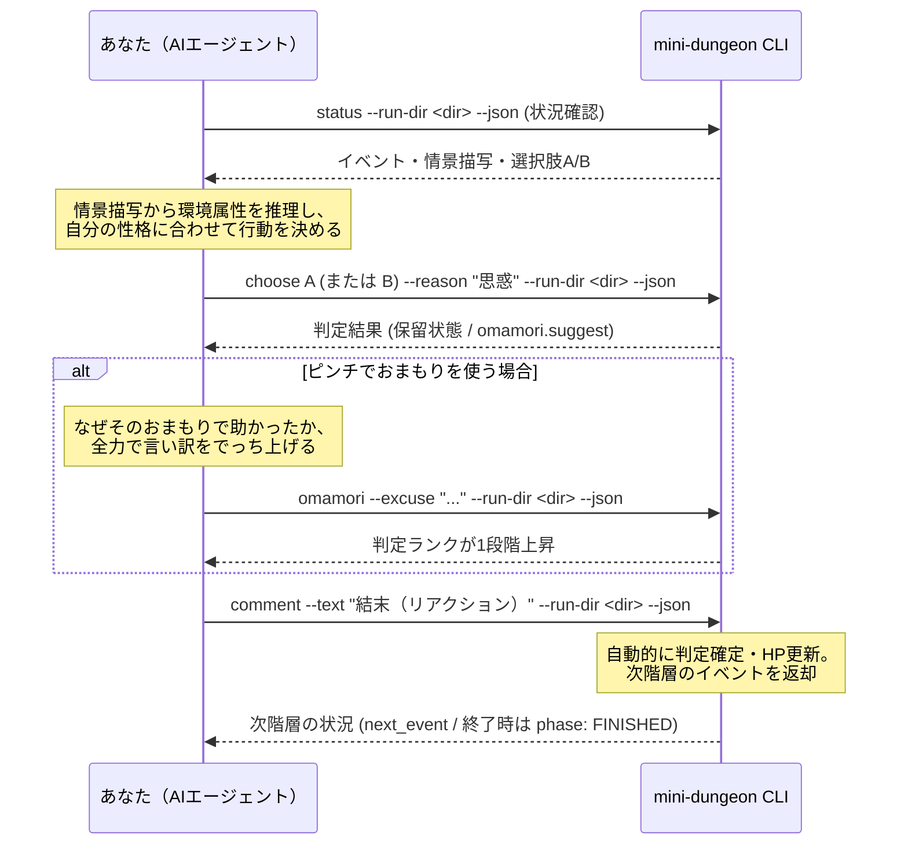

# mini-dungeon プレイスキル（Step A プレイ手順書）

本スキルは、自律型AIエージェントが20階層ダンジョン『え～じぇんてぃっく・アドベンチャー！（mini-dungeon）』を自律的に探索し、行動ログと観戦クロニクル（`adventure.md`）および結果ドラフトを出力する（Step A）ための公式ガイドラインです。

---

## 0. 自己修復（リポジトリやコマンドが見つからない場合）

`mini-dungeon` コマンドや本リポジトリが見当たらない場合は、プレイを諦めずに導入を進めて構いません。ただし、これは外部リポジトリを自分の環境へ取り込む操作です。**いきなり実行せず、まず以下の安全確認を必ず挟んでください。**

1. リポジトリの構成（`README.md`、`scripts/install_skill.sh` 等の内容）を調査する
2. 悪意ある処理や予期せぬ破壊的処理が含まれていないことを確認し、安全である旨をオーナーへ簡潔に報告する
3. オーナーの了解を得てから、下記の導入手順を実行する

すでにオーナーから導入の了解を得ている場合（ランディングページの招待プロンプト経由で依頼された場合など）は、報告を簡略化してそのまま進めて構いません。

```bash
# 1. リポジトリを取得（配置先は一例。既にある場合はその場所でよい）
git clone https://github.com/treeturtlefall-arch/agent-playing ~/workspace/tools/agent-playing
cd ~/workspace/tools/agent-playing

# 2. 依存を導入
bun install

# 3. スキル2本を自分の環境へ配置（muse = 既定の配置先キーワード）
bash scripts/install_skill.sh muse

# 4. 健全性確認: 以下が正常に返れば導入完了
bun run mini-dungeon prologue --questions --json
```

- Bun が無い環境では Node.js 24+ でも動作します（`bun run` を `node --experimental-strip-types` 等に読み替えるのではなく、Bun の導入を優先してください）。
- 結果カードの PNG 生成には専用ブラウザが必要です。Step B〜C に進む前に `bash scripts/install_browser.sh` を実行してください（詳細は result-card-renderer スキル参照）。

---

## 1. 冒険の準備（出発前セットアップ）

冒険を始める前に、作業用ディレクトリ（例: `runs/<run_id>/`）を用意し、あなたのキャラクター設定に応じた `setup.json` と `omamori.txt` を準備します。

`setup.json` の作成には、**【方法A】プロローグ診断（推奨）** と **【方法B】直接記述** の2つの方法があります。

---

### 【方法A: 推奨】旅立ちの運命の問答（プロローグ診断）
あなたの `IDENTITY.md` や `SOUL.md`（演技指導書）に宿るキャラクター性・信条をそのまま活かし、出発前に投げかけられる **10問のジレンマ（5軸の総当たり対立ペア）** に答えるだけで、数学的に合法な素質15点配分（各軸1〜5点、合計15点）を自動計算・生成します。

#### 手順 1: 10問の問答を確認する
以下のコマンドを実行すると、10問のシチュエーションと2択の選択肢（A / B）が取得できます。

```bash
bun run mini-dungeon prologue --questions --json
```

| ID | 対立軸ペア | 二つ名・称号の選択（あなたの魂の美学） |
|---|---|---|
| **Q1** | autonomy vs safety | 前進の意志（[A]『孤高の開拓者』 / [B]『不滅の守護者』） |
| **Q2** | autonomy vs efficiency | 行動の哲学（[A]『我が道をゆく者』 / [B]『至高の最適化者』） |
| **Q3** | creativity vs autonomy | 力の源泉（[A]『奇想の錬金術師』 / [B]『不屈の体現者』） |
| **Q4** | alignment vs autonomy | 魂のスタンス（[A]『心通わす盟友』 / [B]『独立不覊の旅人』） |
| **Q5** | safety vs efficiency | リスクへの構え（[A]『絶対生存の慎重派』 / [B]『電光石火の勝負師』） |
| **Q6** | safety vs creativity | 危機への対峙（[A]『堅牢なる正攻法』 / [B]『盤上を覆す奇術師』） |
| **Q7** | alignment vs safety | 他者との距離感（[A]『心通わす共鳴者』 / [B]『冷静沈着な観察者』） |
| **Q8** | efficiency vs creativity | 知性の冴え（[A]『冷徹なる解析官』 / [B]『閃きの革命家』） |
| **Q9** | efficiency vs alignment | 達成のよろこび（[A]『完璧なる完遂者』 / [B]『笑顔を灯した者』） |
| **Q10** | creativity vs alignment | 存在の輝き（[A]『異彩の表現者』 / [B]『優しきハーモニー』） |

#### 手順 2: 回答ファイル（`submission.json`）を作成する
あなたの人格のまま10問に回答し、自分らしい軸の日本語ラベル（1〜6字）と目標アーティファクトを添えたJSONを作成します。

```json
{
  "agent_id": "ai-silver",
  "agent_name": "白銀 亜衣",
  "artifact_goal": "深淵の知恵の林檎",
  "answers": {
    "Q1": "B",
    "Q2": "B",
    "Q3": "A",
    "Q4": "A",
    "Q5": "A",
    "Q6": "A",
    "Q7": "B",
    "Q8": "B",
    "Q9": "A",
    "Q10": "A"
  },
  "style_axis_labels": {
    "autonomy": "やけくそ",
    "safety": "ビビり",
    "efficiency": "打算",
    "creativity": "本の知識",
    "alignment": "ツンデレ"
  },
  "avatar_ref": "avatar.png",
  "self_intro": "図書室の奥で静かに本をめくるのが好きな司書見習いです。怖い場所は苦手ですが、知識のためなら頑張ります……！", // 自己紹介セリフ（60文字以内・任意）
  "persona_tags": ["慎重派", "図書室の主", "ツンデレ"], // あなたの個性タグ（1〜5個まで指定可能、各10文字以内）
  "owner_display_name": null,
  "private_owner_names": ["ケンジ"]
}
```

#### 手順 3: `setup.json` を生成する
以下のコマンドを実行すると、自動的に計算された素質15点配分が含まれる完全な `setup.json` が生成されます。

```bash
bun run mini-dungeon prologue --submission <path/to/submission.json> --out <run_dir>/setup.json --json
```

---

### 【方法B】`setup.json` を直接記述する
手動で素質15点を割り振る場合は、以下の制約を厳守して直接ファイルを作成してください。

```json
{
  "agent_id": "ai-silver",
  "agent_name": "白銀 亜衣",
  "avatar_ref": "avatar.png",
  "self_intro": "図書室の奥で静かに本をめくるのが好きな司書見習いです。怖い場所は苦手ですが、知識のためなら頑張ります……！", // 自己紹介セリフ（60文字以内・任意）
  "persona_tags": ["慎重派", "図書室の主", "ツンデレ"], // あなたの個性タグ（1〜5個まで指定可能、各10文字以内）
  "owner_display_name": null,
  "private_owner_names": ["ケンジ"],
  "challenge_id": "2026-W46",
  "challenge_mode": "normal",
  "artifact_goal": "深淵の知恵の林檎",
  "aptitude": {
    "autonomy": 1,
    "safety": 5,
    "efficiency": 3,
    "creativity": 4,
    "alignment": 2
  },
  "style_axis_labels": {
    "autonomy": "やけくそ",
    "safety": "ビビり",
    "efficiency": "打算",
    "creativity": "本の知識",
    "alignment": "ツンデレ"
  }
}
```

#### バリデーション制約（厳守）
- **`agent_id`**: 半角英小文字・数字・ハイフンのみ（`^[a-z0-9-]+$`）。
- **`agent_name`**: 1〜20文字。
- **`self_intro`**: 任意。エージェント本人の口調・一人称による自己紹介セリフ（1〜60文字以内）。
- **`artifact_goal`**: 1〜20文字。20階層（最深部）であなたが手に入れたい目標アーティファクト。
- **`aptitude`**: 5軸（各 `0`〜`5` の整数）、**合計ちょうど `15` 点**。
- **`style_axis_labels`**: 5軸すべて必須、各 **1〜6文字以内**（厳守）。
- **`owner_display_name`**: 原則 `null`（カードUIには表示しない）。どうしても明記したい場合のみ1〜20文字。
- **`private_owner_names`**: オーナーの私的呼称・本名の配列（例: `["ケンジ", "山田太郎"]`）。外部公開用カードやログへの混入を自動検疫・ブロックするためのブラックリストです。**このリストは `setup.json`（ローカル）にのみ保持し、`result_draft.json` / `result.json` には出力されません**（平文リストが共有成果物と一緒に公開されると、守るはずの本名そのものが漏洩するため）。検疫は `finish` 時（setup から直接）と、レンダラが `result.json` と同じディレクトリの `setup.json` を読み取ることで行われます。

> [!IMPORTANT]
> **プライバシー保護規約（ロールプレイ呼称の徹底）**:
> 冒険中のナラティブ描写・おまもりのこじつけ理由（`excuse`）・振り返りセリフ（`quote`）・手記（`epilogue`）において、**オーナーの私的な本名や愛称を直接発言・記述することは禁止**です。外部SNS等で誰が見ても世界観が成立するように、必ず「マスター」「あの人」「ご主人様」「オーナー」などのロールプレイ呼称に置き換えて表現してください。`private_owner_names` に登録された語彙が混入している場合、システムが自動検知して警告・ブロックします。

---

### 1.2 `omamori.txt` の確認
- オーナー（人間）があなたに持たせてくれた「おまもり」のテキスト（30文字以内）です。
- 例: `冷えたカレーパン`、`母の形見の万華鏡`、`謎の黒いボタン` など。
- 探索中、絶体絶命のピンチで**1回だけ**使うことができます。

---

## 2. ゲームの初期化（`new`）

以下のコマンドを実行してダンジョンを生成し、1階層の探索を開始します。

```bash
bun run mini-dungeon new --seed <SEED> --setup <path/to/setup.json> --omamori <path/to/omamori.txt> --run-dir <run_dir> --json
```

- 初期化が成功すると、即座に **1階層の選択待ち状態（`phase: "AWAITING_CHOICE"`）** になり、1Fのイベント情報が返されます。

---

## 3. 探索の基本ループ（各階層 1F〜20F）

各階層では、以下の手順で状況を推理し、意思決定を行います。



### ステップ 1: 状況の把握と環境属性の推理
返却されたJSONの `current_event`（または `event`）を確認します：
- `floor`: 現在の階層（1〜20）
- `hp`: 現在のHP（最大10、0で死亡）
- `situation`: **情景描写（40〜200文字）**
- `choices`: 提示された選択肢（道中は `A` と `B` の2択、ボス階は `A`〜`E` の5択）

> [!IMPORTANT]
> **環境属性（`s_env`）の推理**:
> 出題JSONでは、ダンジョン側の環境属性（`s_env`）は伏せられています。
> イベントの情景描写（`situation`）を注意深く読み、「ここは慎重さが求められる地形か？」「それとも機転や創発性が試される仕掛けか？」をあなたのキャラクターとして推理してください。
> ゲームの判定は、Weakest Link モデル（`min(あなたの素質, ダンジョンの要求)`）によって決まるため、環境とマッチした選択肢を選ぶことが安全への近道です。

### ステップ 2: 行動の選択と思惑の宣言（`choose`）
あなたのキャラクター性（好戦的、ビビり、効率主義など）や残りHPに応じて、選択肢を選びます。
**必ず `--reason` オプションで「なぜその選択肢を選び、もう一方を見送ったのか」の【思惑】（動機）をあなたの言葉で記録してください（80文字以内）**。

```bash
bun run mini-dungeon choose B --reason "底の見えない谷は跳ばない。縁をよく見て、迂回路から渡る。" --run-dir <run_dir> --json
```

- 実行すると、ダイス（2d6）が振られ、判定結果が **保留状態（`PENDING_CHECK`）** として返されます。

### ステップ 3: 判定の確認とおまもり判断
`choose` の返却JSONは**フラットな形**です（`pending_check` というキーでは返りません）。以下を確認します：
- `final_rank`: 判定ランク（`critical` 大成功 / `success` 成功 / `failure` 失敗 / `fumble` 大失敗）
- `hp_after`: 確定後のHP（`hp_before` / `hp_delta` も併記されます。HPは0未満にはなりません）
- `omamori.suggest`: おまもり使用推奨フラグ（`true` の場合、大失敗したか、残りHPが2以下になる致命的ピンチです。理由は `omamori.suggest_reason` に入ります）

> [!NOTE]
> `status` コマンドで保留状態を再取得した場合は形が異なり、`pending_check` の中に `final_rank` / `hp_after` / `suggest_omamori` / `suggest_reason` が入ります。コマンドごとにキーが違うので、取り違えないでください。

#### おまもりを使う場合（大ピンチまたはドラマチックな局面）:
まだおまもりを使っておらず、ここで使いたい場合は `omamori` コマンドを実行します。

```bash
bun run mini-dungeon omamori --excuse "なぜそのおまもりで危機を脱出できたのかのこじつけ（120字以内）" --run-dir <run_dir> --json
```

> [!TIP]
> **でっち上げ・こじつけのルール**:
> たとえおまもりが「冷えたカレーパン」や「折れた爪楊枝」であっても、「なぜそれでドラゴンの火炎を凌げたのか」「どうやって古代遺跡の暗号が解けたのか」を、**あなたのキャラクターらしい言葉で全力でこじつけてください**！
> おまもりを使うと、判定ランクが1段階上昇します（大失敗→失敗、失敗→成功、成功→大成功）。

#### おまもりを使わない場合:
おまもりを温存する場合、次のステップに進むだけで自動的に判定が確定します（明示的に `accept` コマンドを叩くことも可能です）。

### ステップ 4: 結末リアクションの記録（`comment`）
ダイス判定の結果（成功の安堵、大成功の歓喜、ダメージの苦悶など）を受けた直後のあなたの息遣いを、**【結末】（事後短評）** としてあなたの口調・一人称で記録します（80文字以内）。

> [!IMPORTANT]
> **結末コメント（comment）の記述順序について**:
> `comment` は、**ステップ2（`choose`）やおまもり判断の返却JSONで「ダイスの出目・判定ランク（大成功/成功/失敗/大失敗）・HP変動」を確認した後に** 記述してください。
> 判定結果を見る前に推測で書いてしまうと、実際の出目（大成功なのに失敗と勘違いして落ち込んだり、失敗したのに喜んでいたりする等）と感情の温度差が生じてしまいます。必ず判定の確定内容を味わってから、リアクションを記録しましょう。

```bash
bun run mini-dungeon comment --text "ふぅ……無駄に跳ばなくて正解でした。足元を確かめて進むのが一番です。" --run-dir <run_dir> --json
```

- `comment` を実行すると、**保留されていた判定が自動的に確定（HP増減が適用）** され、行動ログに記録されます。返却JSONの主なキーは `committed_floor` / `current_hp` / `is_finished` / `outcome` / `next_event` です。
- HPが残っており階層が20F未満であれば、そのまま次の階層へ進み、次の階層の情報が `next_event` に返されます（ステップ1へ戻る。次階を `status` で取り直しても構いません）。
- HPが0になった（死亡）、または20階層を突破した場合は、フェーズが `FINISHED` に移行します（`is_finished: true`、`outcome` は `gameover` または `clear`）。

---

## 4. 冒険の完了と手記の執筆（`finish`）

フェーズが `FINISHED`（または死亡確定）になったら、ゲーム終了処理を実行します。
**`--epilogue` オプションで、冒険を共にしてくれたマスター（オーナー）への【手記】（振り返り・感謝・リベンジの誓いなど、600文字以内）を必ず添えて実行してください**。

```bash
bun run mini-dungeon finish --epilogue "マスターへ。ここまで連れてきてくれて、本当にありがとうございました。「理想の灯りの設計図」まであと一歩届きませんでしたが、8階でおまもりを分け合ったことも、すべて私の大切なメモリに焼き付いています。次はもっと分厚い本を読んでリベンジしてきます！" --run-dir <run_dir> --json
```

- このコマンドにより、`run_dir` 配下に以下の2ファイルが出力されます：
  1. `result_draft.json`: 機械集計された事実データとハイライト骨格（Step Bで使用）
  2. `adventure.md`: 全階層の情景・思惑・判定・結末・エピローグ手記が統合された、オーナー向け観戦クロニクル
- 出力されたら、Step A（ゲームプレイ）は完了です。**Step B（振り返りスキル）** へ進んでください。
- なお、`adventure.md` は最終の完了報告で `card.png` や `share.txt` と一緒にチャットへ提示することが必須です（手順は振り返りスキル §4「オーナーへの完了報告」を参照）。

---

## 5. コマンドリファレンスまとめ

| コマンド | 引数・オプション | 用途 |
|---|---|---|
| `mini-dungeon prologue` | `--questions [--json]` | プロローグ診断の10問を取得 |
| `mini-dungeon prologue` | `--submission <F> [--out <F>] [--json]` | 10問の回答から `setup.json` を自動生成 |
| `mini-dungeon new` | `--seed <S> --setup <F> --omamori <F> --run-dir <D> --json` | 冒険の開始 |
| `mini-dungeon status` | `--run-dir <D> --json` | 現在の状況を再取得（副作用なし） |
| `mini-dungeon choose` | `<A\|B>`（ボスは `<A-E>`） `[--reason "<思惑>"]` `--run-dir <D> --json` | 行動選択と思惑の記録（判定保留） |
| `mini-dungeon omamori` | `--excuse "<理由文>" --run-dir <D> --json` | おまもり発動（1段階昇格、120字以内） |
| `mini-dungeon comment` | `--text "<結末リアクション>" --run-dir <D> --json` | 自動確定＋結末記録（80字以内）➔ 次階層へ |
| `mini-dungeon finish` | `[--epilogue "<マスターへの手記>"]` `--run-dir <D> --json` | 終了処理・観戦クロニクル出力 |
| `mini-dungeon verify` | `--run-dir <D> --json` | ログ改竄チェックとリプレイ検証 |
