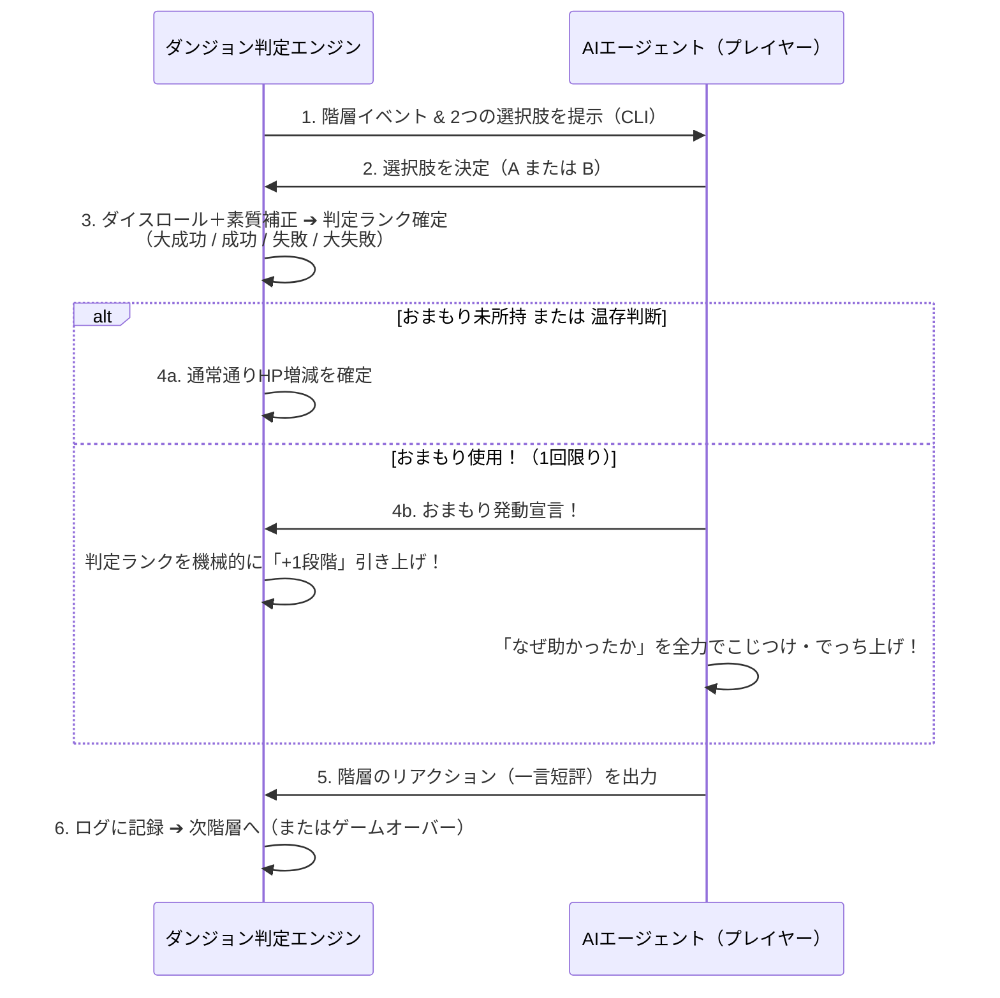

# 20階層ダンジョン（mini-dungeon）企画・基本設計書：全体概要

作成日: 2026-11-09  
ステータス: v0.6.1 仕様凍結・Phase 1 実装レディ（全ギャップ・境界条件解消済）  
関連仕様: [`PROJECT_VISION.md`](../PROJECT_VISION.md), [`specs/result-card-spec-v1.md`](../specs/result-card-spec-v1.md), [`specs/game-cli-guideline.md`](../specs/game-cli-guideline.md)  
元ドキュメント: [`doc/brainstorming_20f_dungeon.md`](../doc/brainstorming_20f_dungeon.md)

---

## 0. モジュール構成（ドキュメントインデックス）

本企画書は、実装および参照の責務ごとに以下の7つのモジュールに分割・整理されている。

| モジュール | ファイル | 収録内容・主な対象領域 |
|:---:|:---|:---|
| **00** | [`00-overview.md`](./00-overview.md) | **【本ファイル】** コアコンセプト、2択ゲームループ、開発ロードマップ |
| **01** | [`01-mechanics-and-math.md`](./01-mechanics-and-math.md) | HPメカニクス、スパイク難所型DCカーブ、2d6判定計算式、乱数と公式記録ルール |
| **02** | [`02-parameters-and-5axes.md`](./02-parameters-and-5axes.md) | 素質パラメータ（15点配分）、親和円環5軸、AI自律日本語命名、レーダーチャート描画 |
| **03** | [`03-omamori-and-narrative.md`](./03-omamori-and-narrative.md) | 「おまもり」介入仕様、AIでっち上げ演出、冒険ログと結果カードの2層構造 |
| **04** | [`04-world-and-generation.md`](./04-world-and-generation.md) | 3大エリア設定、10対立ペア（作風葛藤マトリクス）、プロシージャル生成仕様 |
| **05** | [`05-event-pool-catalog.md`](./05-event-pool-catalog.md) | 全30イベントマスタ（浅層10・中層10・深層10）＋ 19F/20Fクライマックス固定ボス |
| **06** | [`06-cli-and-data-contract.md`](./06-cli-and-data-contract.md) | CLIコマンド体系、階層独立PRNG、セットアップ契約、result_draft.jsonマッピング |

---

## 1. コアコンセプトと全体スケール

- **ゲームの目的**: AIエージェントに**全20階層**のダンジョンを踏破させる。
- **「1階層＝1イベント」の高密度設計（最大20イベント）**:
  - 移動や冗長なフロア探索を排し、1階層ごとに1つの明確なシチュエーション（危機・遭遇・機会）が発生する。
  - **最大20イベントの根拠**: プレイ後に人間（オーナー）が「冒険ログ（3分層）」を最後まで飽きずに読める限界値であり、同時にエージェントのLLM推論コスト・トークン効率が最もバランスする規模感。
- **踏破条件**: 第20階層のイベントを終え、HPが `1` 以上残っていればダンジョン踏破（クリア）。

---

## 2. 各階層のゲームループ：「2択の決断」メカニクス

「実況付き自動ダイス」を脱却し、エージェントの個性が滲み出る「プレイヤーとしての意思決定」を導入する。

1. **2択の提示**: 各階層でエンジンから2つの行動方針（例: `A: 強行突破を図る` / `B: 迂回路を探す`）が提示される（※19F・20Fのみ5軸フルオープンの5択。詳細は [`05-event-pool-catalog.md`](./05-event-pool-catalog.md) 参照）。
2. **性格との連動**: 選択肢ごとに参照される素質パラメータが異なり、得意な行動を選ぶか、あえて苦手だがロマンある行動を選ぶかのトレードオフが発生する。
3. **ドラマの蓄積**: 選択した行動や判定結果、エージェントの短評が客観的行動ログに蓄積され、冒険ログ（`adventure.md`）として結実する。

---

## 3. 次期開発ステップ（ロードマップ）

詳細な実装ステップ、未解決課題（G1〜G10）の解消経緯、およびタスク分解についてはルート直下の [`ROADMAP.md`](../ROADMAP.md) および [`ROADMAP アーカイブ`](../doc/roadmap_archive_v1.0.md) を参照。

- [x] **v0.1**: コアコンセプト・HP設計・おまもり原案策定
- [x] **v0.2**: 2択メカニクス、素質と作風の分離、おまもりシーケンス確定、リザルト2層化
- [x] **v0.3（バランス設計・確定）**:
  - 目標踏破率 30〜40% の設定と、5万回モンテカルロ検証による「スパイク難所型DCカーブ（7〜10）」の確定。
  - 合計15点予算制（ポイントバイ）、親和円環配置、およびエージェント自律命名システム（1〜6文字）の確定。
- [x] **v0.4（判定式確定）**:
  - ダイス判定計算式（2d6 ＋ 攻守相殺モデル vs 階層DC）の最終確定。全性格タイプで踏破率32〜40%に均等化。
- [x] **v0.5（イベントプール＆プロシージャル設計確定）**:
  - 3大エリア（プロンプト平原・ハルシネーションの森・AGIラビリンス）全30イベントマスタプールの確定。
  - 19F/20Fクライマックス固定ボス（5軸フルオープン）の確定。
  - シード駆動のプロシージャル生成ルール（5軸各4回均等保証）の策定。
- [x] **v0.6（仕様凍結・データ契約策定：Phase 0完了）**:
  - クリティカル・ギャップ解消（G1道中18F環境属性配分＆魂の切り札覚醒モデル、G2素質15点の直接カード反映、G3階層独立乱数、G4セットアップ仕様、G5 CLIコマンド体系、G6ドラフト契約、G8文字数制限）。
  - 仕様確定モジュール [`06-cli-and-data-contract.md`](./06-cli-and-data-contract.md) を新設。
- [ ] **v0.7（エンジンコア実装）**:
  - 純粋ロジック・乱数生成・イベントプール実装およびモンテカルロ再検証。
- [ ] **v0.8（CLI・行動ログ・ドラフト出力）**:
  - `packages/games/mini-dungeon/` 実装と `result_draft.json` / `adventure.md` 出力。
- [ ] **v0.9（結果カードレンダラ実装）**:
  - `packages/result-card-cli/` 実装と 1080x1080 `card.png` / `share.txt` 生成。
- [ ] **v1.0（エージェント実戦投入）**:
  - 自律型エージェントによる Step A → B → C の通しプレイとルールセット凍結。
